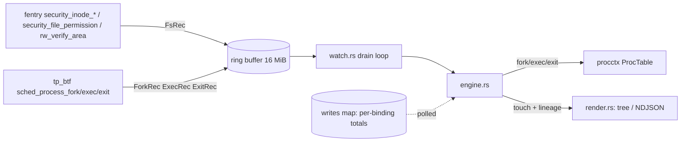

# fsblame — notes for agents and maintainers

fsblame answers "which command changed this file?": it watches files and directory trees and
prints every modifying operation with the full lineage of the process behind it (argv, cwd,
ancestors, systemd unit, and the build step such as an npm `postinstall`). It is an MVP: a
C CO-RE BPF object loaded with aya 0.14, shipped as one static musl binary.

## Layout

| Path | What |
|------|------|
| `crates/fsblame-abi` | Kernel/user ABI (`wire!` structs and constants). `build.rs` of `fsblame-bpf` renders it to `fsblame_wire.h`, which static-asserts every size and offset. |
| `crates/fsblame-bpf` | `bpf/fsblame.bpf.c` (the tracer) and `bpf/probe.bpf.c` (do-nothing programs for `doctor`), compiled by `build.rs` with clang (`-target bpf -O2 -mcpu=v3`). Needs only clang. |
| `crates/fsblame` | The CLI: `tracer.rs` (load/attach, failure causes), `watch.rs` (drain loop), `engine.rs` (records → touches, write coalescing, lineage), `record.rs` (decoding), `roots.rs` (watch roots, path rebuild), `render.rs` (tree view, NDJSON), `doctor.rs`. |
| `xtask` | `cargo xtask test-e2e`. |
| `../tracekit` | Path dependencies `wire`, `procctx` (process table, lineage, origin), `bpfdoctor` (shared checks). **Do not modify tracekit from this repo.** |

## Build, run, test

`/tmp` is tmpfs with a tight quota and `nosuid`. Always build with:

```sh
export TMPDIR=~/.cache/fsblame-tmp CARGO_TARGET_DIR=~/.cache/fsblame-target
mkdir -p "$TMPDIR"

cargo build --release --target x86_64-unknown-linux-musl   # shipped static-pie binary, ~3 min (LTO)
cargo build -p fsblame                                       # fast debug build for iteration
cargo test --workspace                                       # unit tests
cargo xtask test-e2e                                         # builds release, runs e2e (see below)
cargo xtask test-e2e --bin "$CARGO_TARGET_DIR/debug/fsblame" --only c,j   # quick e2e subset
```

Run:

```sh
BIN=$CARGO_TARGET_DIR/x86_64-unknown-linux-musl/release/fsblame
sudo $BIN watch ~/proj                      # tree view; Ctrl-C stops and flushes
sudo $BIN watch ~/proj --json --duration 30s --op write,rename --exclude ~/proj/target
sudo $BIN doctor ~/proj                     # what works here and why not
sudo $BIN doctor --json ~/proj | jq .ops    # per-op availability, machine-checkable
FSBLAME_LOG=debug sudo -E $BIN watch ~/proj # per-program verifier instruction counts, full verifier logs
```

Exit codes: 0 clean stop, 2 usage, 4 privileges, 5 kernel unsupported, 6 runtime error.

## Architecture



### Probes and attach points

| Program | Attach | Reports | If unavailable |
|---------|--------|---------|----------------|
| `on_create`, `on_mkdir`, `on_mknod`, `on_symlink`, `on_link`, `on_unlink`, `on_rmdir` | `fentry/security_inode_<op>` | that op | op skipped with a warning |
| `on_file_post_open` | `fentry/security_file_post_open` (Linux ≥ 6.9) | create by an `open(O_CREAT)` whose name was not in the dentry cache: `may_o_create` calls `security_inode_create` before the lookup (the dentry is still `d_in_lookup`), so `on_create` leaves it to this hook, which reports it only if the open set `FMODE_CREATED`; `creating` carries the dentry per thread (matched by dentry, since an overlay's create runs its own upper-layer create in between) | such an open of an existing file is reported as a create |
| `on_rename` | `fentry/security_inode_rename` | rename (old + new path); bumps `dir_epoch` on directory moves | always loaded, even without `--op rename` (then only the epoch bump survives dead-code elimination) |
| `on_renamed` | `fexit/vfs_rename` | bumps `dir_epoch` again once a directory has moved: a scope walk between `on_rename`'s bump and the move cached a verdict from the old tree | always loaded; without it such a verdict lasts until the next directory rename |
| `on_setattr` | `fentry/security_inode_setattr` | chmod, chown, truncate, utimes, setattr (by `ia_valid`) | ops skipped |
| `on_rw_verify_area` | `fentry/rw_verify_area` | stashes the write's byte count per CPU | writes still reported, without byte counts |
| `on_file_permission` | `fentry/security_file_permission` (`MAY_WRITE`, regular files) | write (first write per `(tgid, struct file)` binding) | write skipped |
| `on_fork`, `on_exec`, `on_exit` | `tp_btf/sched_process_{fork,exec,exit}` | process lineage | **required**: load fails (exit 5) |

On this host (Linux 7.2.6-arch2-1, x86_64) every hook above is listed in
`/sys/kernel/tracing/available_filter_functions` (ftrace-attachable) and present in vmlinux BTF,
and `btf_trace_sched_process_{fork,exec,exit}` exist; `fsblame doctor` re-checks this on any host
(`probe.fentry_security`, `probe.sched_tp`, `probe.ops`). Kernel ≥ 5.17 (`bpf_loop`).

`Tracer::load` attaches the sched tracepoints first (lineage complete before the first file
event), then each wanted fentry hook. A hook that fails for an `Unsupported` cause (missing
function, verifier limit, verifier rejection) is skipped and listed; a privilege failure aborts.
If no selected op is reportable the load fails. The file hooks report nothing until the loader
sets the `armed` global (`.data.armed`) after the last attach: each hook is loaded, verified and
attached in turn, so without the gate the first hooks reported for hundreds of milliseconds
while later ones (`on_rename`) were not attached yet. Every op starts at the same instant,
before the `watching` line and `--ready-fd`; changes made before it are not reported.

### Wire records (`fsblame-abi`)

Every record starts with `RecHeader { kind, op, flags, ts_ns }`.

- `ForkRec` (parent, child tgid, child `start_boottime`), `ExitRec` (tgid, code, start) — fixed.
- `ExecRec` + payload: execve filename, the raw environment block, raw argv. The environment is
  captured whole up to `ENV_CAP` (8 KiB); a longer one keeps its first and last halves
  (`F_ENV_TRUNC`) because tools append their variables (npm's `npm_lifecycle_event` follows the
  inherited environment). `Exec::env_entries` drops the two entries cut at the gap. cwd is not
  in the record (an in-kernel walk cost too much verifier budget); procctx reads
  `/proc/<pid>/cwd` when the event is handled.
- `FsRec` + payload: `path_len` bytes of dentry names, leaf first, NUL-terminated, then `path2`
  (rename: old name; link: existing name; symlink: raw target with `root2 == ROOT_RAW`). `root` /
  `root2` say what the names are relative to: a watch root id, `ROOT_FSROOT` (the side outside
  every root), or `ROOT_NONE`. `aux`/`aux2` are op-specific (see the table on `FsRec`).

Maps: `events` (ringbuf), `roots` (`(dev, ino)` → id/flags), `verdicts` (LRU, dentry → scope),
`writes` (LRU, `(tgid, file)` → totals), `creating` (LRU, tid → dentry of an open-create that
`on_file_post_open` confirms), `stash` (per-CPU byte count), `fs_buf`/`exec_buf` (per-CPU
scratch; each fentry program owns its `fs_buf` slot), `stats` (ring drops). `.rodata`:
`self_tgid`, `op_mask`, `dev_filter` — the verifier treats them as constants, so deselected ops
compile away. `.bss`: `dir_epoch`, `creates_confirmed` (set by `on_file_post_open` when it first
runs); `.data.armed`: `armed`, a map of its own so the loader sets it without writing `dir_epoch`.

### Watched-path matching

Userspace (`Roots::resolve`) canonicalizes each watch/exclude path and pins it by
`(superblock dev, inode)`; every mount below a watch root becomes an extra ("nested") root
because the kernel walk does not cross mounts. A path through a `/proc/<pid>/root` (or `cwd`)
link into another mount namespace is refused (`roots::canonical`): canonicalizing yields the
path there, which names another file here (a container's `/etc` becomes the host's); the error
names where this namespace sees the same file, such as a container's merged directory or the
host side of a volume. In the kernel, `scope_of(dentry)`:

1. `dev_filter`: one compare per watched superblock; other filesystems cost nothing more.
2. `verdicts` LRU keyed by dentry pointer, valid while the dentry's parent, inode number and
   the global `dir_epoch` match. `on_rename` bumps `dir_epoch` whenever a directory moves on a
   watched filesystem, and `on_renamed` again after the move, invalidating every cached verdict.
3. Otherwise a `bpf_loop(SCOPE_WALK_MAX = 4096)` `d_parent` walk looking each ancestor's inode
   up in `roots`; the first root or exclude wins. The verdict records the root id and the
   depth. The walk reaches the root of any path the kernel resolves in one call, so a change
   deeper than the `WALK_MAX` (64) names a record carries is still reported, truncated.

Overlays (module docs of `roots.rs`): a change made through an overlay's merged view reaches the
hooks twice in the same process, as the overlay's operation and as overlayfs's operations on the
upper layer (plus the copy-up or whiteout steps in its work directory). fsblame reports only the
overlay's, at the merged path: `Roots::resolve` excludes the `upperdir=`/`workdir=` of every
overlay it watches, watches a path inside an upper layer through its merged counterpart, and
brings an overlay's merged view into scope when its upper layer lies in a watched tree. Relative
layer options (Docker and Podman use them for long layer lists) are resolved below the ancestors
of the mount point, confirmed by the `work` subdirectory overlayfs keeps. On this host
`stat` inode numbers of merged-view files equal the kernel's `i_ino` with xino on, off and on a
single filesystem (checked through `/proc/locks`); with layers on several filesystems and xino
off, directory numbers are reassigned on every inode load and can equal a file's, so roots below
such an overlay's root are held open and `fsblame.watchfs` warns. Before Linux 6.9 overlayfs
opened a layer's file under the overlay's path (`open_with_fake_path`, then a backing file), so a
write through the overlay passed the write hook again with that file; `layer_file` (its inode is
not its dentry's) makes `on_file_permission` and `report_mapped` skip it.

### Path reconstruction

`emit_names` walks `d_parent` again and writes up to `depth` names (leaf first) into the slot's
scratch, at most `PATH_CAP` (1024) bytes per path; userspace (`Roots::path`) reverses them and
joins them to the root's canonical path. A side outside every root is emitted relative to its
filesystem root (`ROOT_FSROOT`) and mapped back through mountinfo. Truncated walks set
`F_PATH_TRUNC`/`F_PATH2_TRUNC` and render with a leading `…`.

### Writes

`rw_verify_area` stashes the requested count per CPU; the `security_file_permission(MAY_WRITE)`
that follows consumes it and accumulates into `writes[(tgid, file)]`. Only the first write of a
binding emits a record; userspace polls the totals and reports a write window when the file is
quiet for 200 ms, held for 1 s, the process exits, or fsblame stops. A reused `struct file`
hands over the old totals (`F_REPLACED`).

### Lineage

`engine.rs` feeds fork/exec/exit to `procctx::ProcTable`. The fork event's parent wins over the
exec record's `real_parent` (which is the reaper if the parent already exited). On a file event
the actor's cwd is read from `/proc` if missing and the ancestry is loaded while it is alive;
writes of an exiting process are reported before its record is buried. `classify_origin`
derives the build step (npm/pnpm/yarn lifecycle, cargo build script, make, pip) from the
allow-listed environment of the chain.

## Verifier budget (read before touching `fsblame.bpf.c`)

The verifier stops at 1,000,000 processed instructions per program (`E2BIG`, "BPF program is
too large"). `bpf_loop` callbacks are verified repeatedly until the loop state converges;
imprecise scalars are widened, but a scalar that is *precise* (used as a memory offset or helper
size) in the caller's stack frame takes a new value every iteration, so every iteration is a new
state. Two dentry walks in one program (rename, link) multiplied that past the limit.

Rules that keep every program small:

- **Loop cursors used as offsets live in map values, not in the `bpf_loop` context on the
  stack.** `fs_scratch.cur` holds the path-walk write cursor; the verifier does not track map
  contents, so each `walk_step` iteration starts from the same state.
- **Clamp to a compile-time constant right before a variable-length write**, never bound it by
  another running scalar:
  `pos = s->cur; if (pos > FS_DATA_MASK) pos = FS_DATA_MASK; bpf_probe_read_kernel_str(&s->data[pos], NAME_CAP, ...)`.
  Buffers carry slack after the mask for the largest single write; the logical offsets never
  reach the mask.
- **No per-entry scans or string matching in the kernel.** The environment is copied raw (head
  and tail) and filtered by procctx; cwd is read from `/proc`.
- Size arguments are constants or clamped (`ENV_CAP / 2`, `ARGV_CAP`, `PATH_CAP`).

Verified instruction counts on 7.2.6 (from `sudo fsblame doctor --json | jq '.ops'`):
`on_rename` 3,208, `on_link` 3,126, `on_file_permission` 1,606, `on_mmap_file` 1,295,
`on_setattr` 1,036, `on_create` 1,030, `on_symlink` 1,011, `on_mknod` 976, `on_mkdir` 968,
`on_unlink`/`on_rmdir` 950, `on_renamed` 62 (before the cursor fix: single-walk programs
~95k–392k, rename/link > 1,000,000). The path walk's end state (`cut`, `top`) lives in the
scratch map value like its cursor: on the stack, each way a walk can stop was a verifier state
of its own for the rest of the program (2x the instructions, 6x for rename/link).

The loader asks for verifier statistics only (`VerifierLogLevel::STATS`); `FSBLAME_LOG=debug`
requests the full instruction trace. A full trace of a program at the limit is hundreds of
megabytes and aya re-verifies with ever larger buffers, which turned a rejected program into a
multi-minute "hang" at start-up.

## Privileges

fsblame needs `CAP_BPF` and `CAP_PERFMON` (optional `CAP_SYS_PTRACE` for argv/cwd/environ of
other users' processes that started before fsblame). Either run it with `sudo` or grant file
capabilities once: `sudo setcap cap_bpf,cap_perfmon+ep /path/to/fsblame`. File capabilities are
ignored on `nosuid` mounts such as `/tmp`, so install the binary on a disk filesystem (e.g.
`~/.local/bin`). Without capabilities `watch` prints the failing preflight checks, including the
`setcap` line, and exits 4.

## Doctor

`fsblame doctor [--json] [PATH...]` runs bpfdoctor's shared checks (platform, kernel version
and BTF, capabilities, file caps, nosuid, no_new_privs, lockdown, LSMs, sysctls, memlock,
namespaces, seccomp, cgroup2, hidepid, ring buffer, memcg) plus:

- `probe.fentry_security`: an fentry trampoline attaches to `security_inode_unlink`, then to
  every tracer hook function (probe object).
- `probe.sched_tp`: the three sched `tp_btf` tracepoints attach.
- `probe.ops`: loads every fentry program of the **real** tracer, shaped for the given paths,
  and reports each op as available or disabled with a distinct cause:
  `verifier-limit` (E2BIG/ENOSPC; "on_X exceeded the BPF verifier instruction limit (N insns >
  1,000,000)", WARN, fix names `--op` without the op; for `on_rename` that loads its reduced
  form), `missing-hook` (not in BTF / not ftrace-attachable), `permission` (EPERM/EACCES before
  verification: caps or lockdown), `verifier-rejected`, `error`. `--json` adds
  `ops: [{name, status, reason, program, insns, detail}]`.
- `fsblame.watchfs`: INFO for paths in an overlay's merged view, in an upper layer, or holding
  upper layers (how they are reported); WARN for an overlay with repeating inode numbers (layers
  on several filesystems, xino off), an overlay whose `upperdir=` is not found here, and network
  and FUSE filesystems.

`watch` runs the fast preflight subset before attaching and prints one line per unusable hook
with the same cause wording.

## End-to-end tests

`cargo xtask test-e2e` runs as the normal user (it refuses root), uses `sudo -n` per scenario,
and works in `~/.cache/fsblame-e2e` (it refuses tmpfs and nosuid mounts). Each scenario starts
`sudo -n fsblame watch --json` on a fresh directory, waits for the `fsblame: watching` line,
runs its workload, sends SIGINT (sudo relays it) and asserts on the NDJSON:

| id | asserts |
|----|---------|
| a | `dd conv=fsync` → `write` touch, `bytes > 0`, `proc.comm == "dd"` |
| b | `touch` + `rm` → `create` and `unlink` for the path |
| c | `mv` across two watch roots → `rename` with `old_path` and new path; `ln` → `link` with `target` |
| d | `chmod 600` → `chmod`, `change.mode == "0600"` |
| e | `mkdir -p a/b/c` + deep write → `mkdir` ×3 and `create`/`write` with the full path |
| f | `sh -c 'sh -c "sleep 0.3; echo x > f" & exit 0'` → writer `sh`, parent is the exited outer `sh`, chain reaches the xtask pid |
| g | npm lifecycle env → `origin.kind == "npm-lifecycle"`, package `demo`, phase `postinstall` |
| h | unprivileged run → exit 4, stderr has `setcap cap_bpf,cap_perfmon+ep` |
| i | copy to `~/.cache/fsblame-e2e/bin`, `setcap`, run as the user → write reported; caps removed after |
| j | `doctor --json` → all 14 ops `available`, `probe.ops` pass (or warn only for hooks absent from BTF, such as `security_file_post_open` before 6.9), rename/link insns < 1,000,000 |
| k | `--duration 2s` → exits 0 about 2 s after attaching |
| l | overlay mounted in the work dir, the whole tree watched (merged view, upper layer, work dir): append to a cold lower file, chmod, rm, create + write, mkdir → each exactly once at its merged path, nothing under `upper/` or `work/`, no create for the appended file (one allowed when `security_file_post_open` could not attach) |

## Known limitations (MVP)

- cwd comes from `/proc/<pid>/cwd` when the event is handled; a process that exits within that
  window (a quick `mv`) shows no cwd, unless it inherited one from a parent fsblame knows.
- Network and FUSE paths are flagged by `fsblame.watchfs`: other clients' changes are never
  seen, and a FUSE daemon's writes to its backing store are attributed to the daemon. Overlays
  are watched through their merged view, but an overlay mounted in another mount namespace
  (rootless Podman) is not visible, so its upper layer is reported as a plain directory, and
  writes through a shared mapping of an overlay file made writable by `mprotect(2)` are not
  seen on any kernel (the hook gets the upper layer's file: a `layer_file` before 6.9, the
  upper path from 6.9).
- A path longer than `PATH_CAP` (1024 bytes) or `WALK_MAX` (64) components below its root is
  cut at the top and marked truncated.
- An environment longer than 8 KiB loses its middle; variables set there (rare: tools append)
  are not seen by origin detection.
