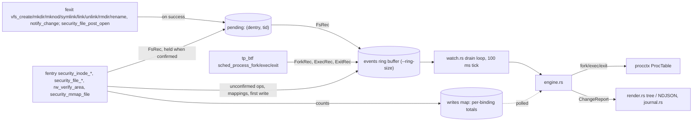

# fsblame: notes for agents and maintainers

fsblame answers "which command changed this file?": it watches files and directory trees and
reports every modifying operation with the full lineage of the process behind it (argv, cwd,
ancestors, systemd unit or container, and the build step such as an npm `postinstall`). It is
a C CO-RE BPF object loaded with aya 0.14, shipped as one static musl binary for x86_64 and
aarch64. Users read [README.md](README.md); the NDJSON schema is [docs/json.md](docs/json.md).

## Layout

| Path | What |
|------|------|
| `crates/fsblame-abi` | Kernel/user ABI: `wire!` structs (`RecHeader`, `ForkRec`, `ExecRec`, `ExitRec`, `FsRec`, map keys and values, `DevFilter`, `ExitShape`) and `wire_consts!`. `build.rs` of `fsblame-bpf` renders it to `fsblame_wire.h`, which static-asserts every size and offset; change the ABI here, never only in C. |
| `crates/fsblame-bpf` | `bpf/fsblame.bpf.c` (the tracer), `bpf/probe.bpf.c` (do-nothing programs per attach point, for `doctor`), `bpf/vmlinux_min.h` (hand-written CO-RE subset of vmlinux.h; every struct is `preserve_access_index`), `bpf/include/bpf/` (vendored libbpf headers, LGPL-2.1 or BSD-2-Clause, with `LICENSE.BSD-2-Clause`). `build.rs` compiles both objects with clang (`-target bpfel/bpfeb -O2 -g -mcpu=v3 -Wall -Werror`; `CLANG=` overrides) and writes the ABI hash shown by `--version`; under `DOCS_RS` it writes empty objects instead (a binary built so cannot load). |
| `crates/fsblame/src` | The CLI and library (modules are public for the fuzz targets and benches). |
| `crates/*/LICENSE` | Copies of the root MIT `LICENSE`, so each published crate ships it. |
| `xtask` | `cargo xtask test-e2e`, `bench`, `man`, `licenses` (`publish = false`). `main.rs`: harness and scenarios a..l; `e2e_core.rs` m..r; `e2e_features.rs` s..ac; `e2e_startup.rs` ad; `e2e_kernelfix.rs` ae..ag, al; `e2e_enginefix.rs` ah, ai; `e2e_skipfix.rs` ak; `bench.rs`; `man.rs` (man pages); `licenses.rs` (`THIRD_PARTY_LICENSES.md`). It compiles `cli.rs`, `clock.rs`, `glob.rs` and `ops.rs` in with `#[path]`, so man pages need no BPF build. |
| `fuzz/` | cargo-fuzz crate (nightly, its own workspace): `record_decode`, `report_line`, `glob_match`. `corpus/` and `artifacts/` are gitignored. |
| `tracekit/` | Git submodule (tracekit v0.1.0): `wire` (ABI macros and header builder), `procctx` (process table, lineage, context, origin classification), `bpfdoctor` (shared checks). **Changes go to the tracekit repository**; here only the submodule pointer moves. |
| `contrib/systemd/` | `fsblame-record.service` (hardened `record` unit) and `fsblame.default` (`/etc/default/fsblame`); shipped in the release archives as `systemd/`. |
| `.github/` | `workflows/ci.yml`, `workflows/release.yml`, `actions/setup` (clang plus the pinned toolchain), issue and PR templates, dependabot. |

Modules of `crates/fsblame/src`:

| Module | Role |
|--------|------|
| `main.rs`, `lib.rs` | Entry point, `--version` text (with the BPF ABI hash), `FSBLAME_LOG` logger, dispatch, exit codes. |
| `cli.rs` | clap definitions. Shared argument groups: `FilterArgs` (watch, run, record, blame), `TraceArgs` (watch, run, record), `StopArgs` (watch, record), `ViewArgs` (watch, run, blame). Depends only on clap, `ops`, `glob`, `clock`. |
| `ops.rs` | `Op` (14 ops, names, verbs), `OpSet` (the BPF `op_mask`), `FS_HOOKS` (24 fentry/fexit hooks in attach order, each `Reports`, `Adds(lost)`, `Supplements(lost)` or `Confirms { lost, shape }`; each confirming fexit follows its check), `SCHED_HOOKS`, `EXEC_CWD_HOOK`. |
| `tracer.rs` | Opens the object, sets `.rodata` (including each `shape_<fn>` from BTF via `exit_shape()`), resizes maps, fills `roots`, loads and attaches (a `Confirms` hook with an unknown shape counts as missing), classifies failures (`Cause`: verifier-limit, missing-hook, permission, verifier-rejected, error), `arm()`s, reads `stats` and the `recursion_misses` (`BPF_OBJ_GET_INFO_BY_FD`) of the programs whose skipped run can lose a change (`Role::skip_loses_changes`: every role but `Supplements`) and of the sched tracepoints. `Tracer` keeps those program fds, the program links (`FdLink`; the kernel keeps the maps alive through the programs) and the maps it reads (`events`, `writes`, `tracked`, `stats`); the rest of the aya object is dropped after loading. `TRACKED_MAX` = 65,536. |
| `btf.rs` | `KernelBtf::read` reads `/sys/kernel/btf/vmlinux` once; the same bytes give aya's parse (to load against) and, through fsblame's own raw BTF parser, kernel function prototypes (`prototypes()`: parameter count, index of the last `struct dentry *`, return kind; `KernelBtf::prototype`). `btf::loader` drops the copy aya's `EbpfLoader::new` parses on its own first, so one parse (about 16 MiB on 7.2) is in memory at a time; the tracer frees it after the last attach, before the ring is mapped. `doctor` shares one parse across its probe checks. |
| `roots.rs` | Watch roots: canonicalizes paths, pins `(dev, ino)`, nested mounts, overlay model, excludes, device filter, path rebuild (`Roots::path`), mountinfo parsing. |
| `ring.rs` | Reader of the `events` ring buffer: maps the consumer page read-write and the producer and data pages once, read-only (aya's `RingBuf` maps the data twice, all resident, which showed the 16 MiB ring as 32 MiB of RSS); copies the one record per lap that wraps into a reused buffer. Keeps aya's memory ordering (acquire header and producer loads, release consumer store, fence before rechecking). `Ring::mark` notes the producer position at a stop, `passed` says whether reading got there, `unread` counts the committed and busy records left before it (safe because the kernel writes each length before it releases the producer position). |
| `record.rs` | Decodes ring buffer items (`Record::{Fork, Exec, Exit, Fs}`) and their payloads; never panics (fuzzed). |
| `engine.rs` | Records to touches: feeds procctx, write bindings and windows (moved to the new path by a rename, given the new comm by an exec), exec/exit flushes, lineage cache, filter, emits `ChangeReport`s. `engine_tests.rs` drives it with synthetic records, a fake `writes` map and `/proc` fixtures. |
| `watch.rs` | The drain loop shared by watch, record and run (`run`, `follow`, `Follow`), signals via signalfd, epoll, loss meters, banners, `--tree`. |
| `run.rs` | `fsblame run`: fork, park the child until it is tracked, drop to the sudo user, exec; pidfd for the end; exit status passthrough. `open_output` (`-o`): `O_NOFOLLOW \| O_NONBLOCK`, new file 0600 owned by the invoking user; an existing one must be a regular file of the invoking user (the euid without sudo) and is reopened with `O_CREAT` without sudo so `fs.protected_regular`/`protected_fifos` apply. |
| `report.rs` | The report model: `Line` (`touch`, `lost`, `summary`), schema version, loss reasons (`ring-full`, `write-evicted`, `track-full`, `unread`, `skipped`, and `other` for an unknown one read back; `LossTotals` fields after the first default to 0 when parsing, unknown keys are ignored; `LossTotals::by_reason`), `LineEncoder` (reuses encoded lineages, 64 slots), `Summary`. |
| `render.rs` | Sinks: `Human` (tree view, color palette, `~` for home; every reported text goes through `escape`, arguments through `quote` with bash `$'...'` for control characters) and `Json`. |
| `filter.rs`, `glob.rs` | Change selection (cheapest test first: pid, uid, comm, ignore_comm, unit, include) and byte-wise gitignore-style globs (never allocate while matching; fuzzed). |
| `journal.rs` | `fsblame record` (`journal::command`, the watch loop with a journal sink) and the rotating NDJSON journal: `fsblame-<UTC start>.ndjson`, one `write(2)` per line and nothing buffered (a crash can only tear the last line), dir 0700 and files 0600, rotation at `--max-size`, oldest beyond `--keep` deleted, first file created at the first line. |
| `blame.rs` | `fsblame blame`: reads the journal files in name order through one buffer, pre-checks each line's timestamp and the queried path as a JSON substring before parsing, matches a change by any of its paths component-wise (as given, with parent symlinks resolved, and canonical), keeps a `--limit` ring, skips torn lines, and renders through the `watch` sinks. |
| `doctor.rs` | `doctor` and the `watch` preflight: bpfdoctor's shared checks plus fsblame's probes and `fsblame.watchfs`. |
| `clock.rs` | `CLOCK_BOOTTIME` to wall clock, RFC 3339 formatting and parsing. `Clock::resample` (every loop pass) detects wall-clock steps beyond the sample error plus 1 ms; events up to the last sample before a step keep the old offset, and one earlier step is remembered. |
| `fail.rs` | `Failure` and its exit codes. |

## Build, run, test

`/tmp` on the maintainer host is a small `nosuid` tmpfs. Build with:

```sh
export TMPDIR=~/.cache/fsblame-tmp CARGO_TARGET_DIR=~/.cache/fsblame-target
mkdir -p "$TMPDIR"

cargo build --release --target x86_64-unknown-linux-musl   # shipped static-pie binary (LTO)
cargo build -p fsblame                                       # fast debug build for iteration
cargo test --workspace                                       # unit tests
cargo clippy --workspace --all-targets -- -D warnings        # clippy::pedantic is on
cargo xtask test-e2e                                         # builds release, runs every scenario
cargo xtask test-e2e --bin "$CARGO_TARGET_DIR/debug/fsblame" --only c,j   # quick subset
cargo xtask bench --quick                                    # what watching costs
cargo xtask man                                              # man pages into $CARGO_TARGET_DIR/man
cargo xtask licenses                                         # THIRD_PARTY_LICENSES.md into $CARGO_TARGET_DIR
```

Run:

```sh
BIN=$CARGO_TARGET_DIR/x86_64-unknown-linux-musl/release/fsblame
sudo $BIN watch ~/proj                       # tree view; Ctrl-C stops and flushes
sudo $BIN watch ~/proj --json --duration 30s --op write,rename --exclude ~/proj/target
sudo $BIN run -- sh -c 'echo hi > ~/x'       # one command's changes, anywhere
sudo $BIN doctor ~/proj                      # what works here and why not
sudo $BIN doctor --json ~/proj | jq .ops     # per-op availability and verifier insns
FSBLAME_LOG=debug sudo -E $BIN watch ~/proj  # per-program verifier insns, full verifier logs on failure
```

Exit codes: 0 clean stop, 2 usage, 4 privileges, 5 kernel unsupported, 6 runtime error; `run`
passes the command's status through (128 + N for signal N, 127 not found, 126 not
executable).

## Architecture



### Probes and attach points

Optional programs (`FS_HOOKS`, then `EXEC_CWD_HOOK`) are skipped with a warning naming what is
lost when they cannot attach for an `Unsupported` cause; a privilege failure aborts. Roles
(`ops::Role`): `Reports` (its ops are not reported without it), `Adds` (reports changes the
reporting program does not see, or commits those it held: `on_mmap_file`, `on_file_mprotect`,
`on_file_post_open`), `Supplements` (detail only, no change lost without it:
`on_rw_verify_area`, `on_file_free`, `on_exec_cwd`), `Confirms` (an fexit on the VFS function
that runs a check: with it attached the check holds its record in `pending`, and the fexit
submits it only on success).

| Program | Attach | Role | Without it |
|---------|--------|------|------------|
| `on_rw_verify_area` | `fentry/rw_verify_area` | stashes the byte count of the write in flight, per CPU | writes reported without byte counts |
| `on_file_free` | `fentry/security_file_free` | ends an open instance of a `struct file` (`files` delete) | a reused `struct file` is told apart only by inode pointer and `i_generation`; successive opens of one file may be one window |
| `on_file_permission` | `fentry/security_file_permission` (`MAY_WRITE`, regular files) | write: counts into `writes`; the first write of a binding emits a record | write not reported |
| `on_mmap_file` | `fentry/security_mmap_file` (Adds) | `mmap(MAP_SHARED, PROT_WRITE)` of a file open for writing: one record per binding (`F_MAPPED`, `MAP_VIA_MMAP`) | writes through shared mappings not reported |
| `on_file_mprotect` | `fentry/security_file_mprotect` (Adds) | read-only shared mapping made writable (`MAP_VIA_MPROTECT`) | those writes not reported |
| `on_create` | `fentry/security_inode_create` | create check. Reported at once until `creates_confirmed` is set (before 6.9 an open's create would be stranded: it never reaches `vfs_create`). Then held when `vfs_create`'s fexit is attached or the dentry is still `d_in_lookup` (`open(O_CREAT)` checks before its lookup); committed by `on_vfs_create` or `on_file_post_open` | create not reported |
| `on_file_post_open` | `fentry/security_file_post_open` (6.9+, Adds) | commits the held create of an open that set `FMODE_CREATED`, with the new file's inode; sets `creates_confirmed` on its first run | `open(O_CREAT)` creates reported at the check (ino 0, requested mode), failed ones and cold opens of existing files too |
| `on_vfs_create` | `fexit/vfs_create` (Confirms) | commits creates made through `vfs_create` (mknod(2), overlayfs, nfsd) on success, with the new inode | failed creates may be reported |
| `on_mkdir`, `on_mknod`, `on_symlink`, `on_link`, `on_unlink`, `on_rmdir` | `fentry/security_inode_<op>` | that op's check, held by its dentry (link: the new one) | op not reported |
| `on_vfs_mkdir`, `on_vfs_mknod`, `on_vfs_symlink`, `on_vfs_link`, `on_vfs_unlink`, `on_vfs_rmdir` | `fexit/vfs_<op>` (Confirms) | commit the held record on success; mkdir, mknod and symlink with the new inode | failed ops reported, made names with ino 0 |
| `on_rename` | `fentry/security_inode_rename` | rename check (new + old path, flags, replaced inode; held by the old dentry); bumps `dir_epoch` when a directory moves on a walked filesystem | always attached; without `--op rename` only the epoch bump survives |
| `on_vfs_rename` | `fexit/vfs_rename` (Confirms) | on success, bumps `dir_epoch` again (a walk between the bumps cached the old tree) and commits the rename | always attached; such a verdict lasts until the next directory rename, failed renames reported |
| `on_setattr` | `fentry/security_inode_setattr` | truncate, chown, chmod, utimes, setattr, tested in that order on `ia_valid` (owner before mode: a chown of a setuid file also sets `ATTR_MODE`) | ops not reported |
| `on_notify_change` | `fexit/notify_change` (Confirms, `OP_CHMOD..OP_SETATTR`) | commits the held attribute change on success | failed ones reported (a chmod by a non-owner) |
| `on_exec_cwd` | `tp_btf/sched_process_exec`, attached before `on_exec` | walks the new image's cwd up to the mount-namespace root into `cwd_buf` | cwd read from `/proc` when the event is handled, too late for quick processes |
| `on_fork`, `on_exec`, `on_exit` | `tp_btf/sched_process_{fork,exec,exit}` | lineage records; `on_fork`/`on_exit` maintain `tracked` | **required**: load fails (exit 5) |

On 7.2.6 every hook is ftrace-attachable and in vmlinux BTF; `doctor` re-checks on any host
(`probe.fentry_security`, `probe.sched_tp`, `probe.ops`). `security_file_post_open` exists
from 6.9 only; everything else from the 5.17 floor.

`Tracer::load` attaches `on_exec_cwd`, then the sched tracepoints (lineage complete before the
first file event), then each wanted fentry/fexit hook. If no selected op has a reporting hook
the load fails with that hook's error. File hooks report nothing until the loader sets
`armed` (`.data.armed`) after the last attach: hooks are loaded, verified and attached one by
one, and without the gate early hooks reported for hundreds of milliseconds while later ones
(`on_rename`) were not attached. Every op starts at the same instant, before the
`fsblame: watching` line and `--ready-fd`; changes before it are not reported. `armed` is
`ARMED_ON` plus bit `1 << OP_*` of each op whose confirming fexit attached (`confirmed(op)` in
C); an op whose fexit did not attach is reported at its check, as before 0.1.1, and the warning
names what is lost.

### Holding and confirming (`pending`)

`security_inode_*` checks run before the filesystem acts, so a check alone reported failed
operations. A check of a confirmed op builds its record as before, then `finish_fs` copies it
(header plus payload, `struct pending_rec`) into the LRU hash `pending` (1,024 entries) under
`(dentry, tid)`, deciding after the path walks (a branch before them doubled the verifier
insns of link and rename); if the insert fails the record is submitted at once. The fexit
(`CONFIRM(fn, first, last)` macro) reads its dentry with `bpf_get_func_arg(shape_<fn>.arg)`
and the return with `bpf_get_func_ret`; `commit()` submits the record with a fresh timestamp
if the call succeeded and the op is in `first..last`, and deletes the entry either way. For a
name the call made (`CONFIRM(..., makes)`: create, mkdir, mknod, symlink; `vfs_mkdir`'s
returned dentry where it returns one; the opened file's for `on_file_post_open`) it also sets
`ino` and `mode` from the new inode, so they are what the filesystem settled (umask, default
ACL, setgid directory); a record reported at its check keeps ino 0 and the requested mode. The
dentry in the key keeps an overlay's nested calls on the upper layer apart from the outer one.
Each check that may hold first `forget()`s its key, reported or not, so a record stranded by a
call whose fexit never came (an open that failed after its create check, an fexit the kernel
skipped) is not committed by a later call that ran its own check. A later call that ran no
check (its fentry skipped, a `vfs_rename` of two names of one inode, a `notify_change` with
nothing left to do) can still commit a stranded record; covering that needs an fentry on every
VFS function.

Prototypes differ by kernel: 5.17 and 6.1 pass a `user_namespace *`, 6.6 and 6.12 a
`mnt_idmap *`, 7.2 adds a trailing `delegated_inode *` to most of these functions, and
`vfs_mkdir` returns `struct dentry *` from 6.15. `vfs_link`'s new dentry is argument 3;
`vfs_rename` takes a `struct renamedata *` everywhere (so `on_vfs_rename` has no shape).
`security_inode_setattr` has 2 parameters on 5.17 and 3 from 6.1 (`setattr_idmap`).

### Wire records (`fsblame-abi`)

Every record starts with `RecHeader { kind, op, flags, ts_ns }` (`CLOCK_BOOTTIME`).

- `ForkRec` (parent tgid, child tgid, child `start_boottime`) and `ExitRec` (tgid, `exit_code`,
  start): fixed size. Threads are not reported; `ExitRec` only for the last thread.
- `ExecRec` + payload: execve filename (`FILENAME_CAP` 256), the raw environment block, raw
  argv (`ARGV_CAP` 4 KiB, `F_ARGV_TRUNC`), then with `F_CWD` the cwd as dentry names leaf
  first up to the mount-namespace root (none: `/`; `F_CWD_TRUNC`: upper part missing). The
  environment is copied whole up to `ENV_CAP` (8 KiB); a longer one keeps its first and last
  halves (`F_ENV_TRUNC`) because tools append their variables (npm's `npm_lifecycle_event`
  follows the inherited environment); `Exec::env_entries` drops the two entries cut at the gap.
- `FsRec` + payload: `tgid`, `tid`, `ns_tgid` (pid in its own pid namespace, 0 in the initial
  one), `start_ns`, `comm`, `uid`, `dev`, `ino`, `mode`, `root`/`root2`, `path_len`/`path2_len`,
  `aux`/`aux2`, `bytes`, `file`. Paths are dentry names leaf first, NUL-terminated; `path2` is
  the rename's old name, the link's existing name, or a symlink's raw target
  (`root2 == ROOT_RAW`). `root` is a watch root id, `ROOT_FSROOT` (relative to the
  filesystem root, mapped back through mountinfo) or `ROOT_NONE`.

| op | path | path2 | aux | aux2 |
|----|------|-------|-----|------|
| `OP_WRITE` | file | – | replaced binding's bytes (`F_REPLACED`) | replaced binding's calls |
| `OP_WRITE` + `F_MAPPED` | file | – | `MAP_VIA_MMAP`/`MAP_VIA_MPROTECT` | – |
| `OP_RENAME` | new name | old name | rename flags | inode replaced at the new name |
| `OP_LINK` | new link | existing name | – | – |
| `OP_SYMLINK` | new link | target (`ROOT_RAW`) | – | – |
| `OP_MKNOD` | node | – | `rdev` | – |
| `OP_CHMOD`… | file | – | `ia_valid` | new mode, size, or `uid << 32 \| gid` |

Flags: `F_PATH_TRUNC` 1, `F_PATH2_TRUNC` 2 (for a `ROOT_RAW` symlink target: cut at
`PATH_CAP - 1` bytes, its end missing; userspace appends `…`), `F_REPLACED` 4, `F_MAPPED` 8,
`F_ARGV_TRUNC` 16, `F_ENV_TRUNC` 32, `F_CWD` 64, `F_CWD_TRUNC` 128. A committed record's
`ts_ns` is the time of its fexit, not of its check.

### Maps and globals

| Map | Type, size | Purpose |
|-----|------------|---------|
| `events` | ringbuf, `--ring-size` (default 16 MiB, power of two 256K..1G) | all records |
| `roots` | hash, resized to the root count | `(dev, ino)` → watch root id or `ROOT_F_EXCLUDE` |
| `verdicts` | LRU 65,536 | dentry → `{parent, ino, epoch, root, depth}` |
| `writes` | LRU 16,384 | `(tgid, struct file)` → `{dev, ino, bytes, calls, first_ns, last_ns}`; polled by userspace |
| `mapped` | LRU 4,096 | `(tgid, struct file)` → reported writable mapping `{ino, start_ns, first_ns, dev}` |
| `files` | LRU 16,384 | `struct file` → open instance `{since, inode ptr, i_generation}` |
| `pending` | LRU 1,024 | `(dentry, tid)` → held `pending_rec` (record header plus payload) until its fexit |
| `tracked` | hash, 1 entry, or `TRACKED_MAX` when following | tgids whose changes are reported (`run`, `--tree`) |
| `stash` | per-CPU array 1 | byte count of the write in flight |
| `fs_buf` | per-CPU array, `OP_COUNT + 2` slots | record scratch; each reporting fentry owns a slot (`SLOT_MMAP`, `SLOT_MPROTECT` after the op slots) |
| `exec_buf` | per-CPU array 1 | exec record scratch |
| `cwd_buf` | per-CPU array 1 | the cwd `on_exec_cwd` walked, keyed by `bprm` and tgid, consumed by `on_exec` |
| `stats` | per-CPU array, `STAT_COUNT` | `STAT_RING_DROPS`, `STAT_TRACK_FULL` |

| Global | Section | Meaning |
|--------|---------|---------|
| `self_tgid`, `op_mask`, `dev_filter` | `.rodata` | fsblame's own pid (never reported), selected ops (bit `1 << OP_*`), superblocks holding roots (`MAX_DEVS` 16; count 0 disables the filter) |
| `scope` | `.rodata` | `SCOPE_ROOTS` (watch roots), `SCOPE_ALL` (`run` without paths: every non-pseudo filesystem, no walk), `SCOPE_ALL_EXCLUDES` (the same, walking the excluded superblocks) |
| `track` | `.rodata` | report only tgids in `tracked` |
| `setattr_idmap` | `.rodata` | `security_inode_setattr` takes a leading idmap (6.0+, and backports such as EL9's 5.14); set from the BTF prototype |
| `shape_<fn>` | `.rodata` | `ExitShape { arg, ret_ptr }` of each confirming VFS function (not `vfs_rename`), from its BTF prototype |
| `dir_epoch`, `creates_confirmed` | `.bss` | verdict invalidation counter; set by `on_file_post_open` on its first run |
| `armed` | `.data.armed` | start gate plus confirmed-op bits (`ARMED_ON \| 1 << OP_*`); its own map so the loader writes it without touching `.bss` |

The verifier treats `.rodata` as constants: deselected ops, tracking off and `SCOPE_ROOTS`
compile away.

### Watched-path matching

Userspace (`Roots::resolve`) canonicalizes each watch and exclude path and pins it by
`(superblock dev, inode)`. Every mount below a watch root becomes an extra ("nested") root,
because the kernel walk does not cross mounts; mounts made after start are not added. A path
through `/proc/<pid>/root` or `cwd` into another mount namespace is refused
(`roots::canonical`); the error names where this namespace sees the same file. In the
kernel, `scope_of(dentry, dev)`:

1. Beyond the roots (`scope != SCOPE_ROOTS`): pseudo and kernel-internal filesystems
   (`SB_KERNMOUNT`, proc, sysfs, cgroup, devpts, debugfs, tracefs, bpffs, securityfs, ...) are
   out; otherwise the default verdict is `ROOT_FSROOT`, and with `SCOPE_ALL` that is final.
2. `dev_filter`: one compare per watched superblock; other filesystems cost nothing more.
3. `verdicts` LRU keyed by dentry pointer, valid while the dentry's parent, inode number and
   `dir_epoch` match. `on_rename` bumps `dir_epoch` when a directory moves on a walked
   filesystem, `on_renamed` again after the move.
4. Otherwise a `bpf_loop(SCOPE_WALK_MAX = 4096)` `d_parent` walk looking each ancestor's inode
   up in `roots`; the first root or exclude wins (an exclude gives `ROOT_NONE`; a watch root
   inside an exclude wins over it). The verdict records the root id and the depth. 4096 hops
   cover any path the kernel resolves in one call (`PATH_MAX` holds at most 2048 names), so a
   change deeper than the `WALK_MAX` (64) names a record carries is still reported, truncated.

Overlays (module docs of `roots.rs`): a change through an overlay's merged view reaches the
hooks twice in the same process, as the overlay's operation and as overlayfs's operations on
the upper layer (plus copy-up or whiteout steps in its work directory). fsblame reports only
the overlay's, at the merged path: `Roots::resolve` excludes the `upperdir=`/`workdir=` of
every overlay it watches (or everywhere under `run`), watches a path inside an upper layer
through its merged counterpart, and brings an overlay's merged view into scope when its upper
layer lies in a watched tree. Relative layer options (Docker and Podman use them for long
layer lists) are resolved below the ancestors of the mount point, confirmed by the `work`
subdirectory. Merged-view roots are identified by mountinfo's device and `stat`'s inode
number. With layers on several filesystems and xino off, overlayfs renumbers directory inodes
on every load and they can equal a file's, so roots below such an overlay's root are held
open and `fsblame.watchfs` warns. Before Linux 6.9 overlayfs opened a layer's file under the
overlay's path (`open_with_fake_path`, from 6.6 a backing file), so a write through the
overlay passed the write hook again with that file; `layer_file()` (its inode is not its
dentry's) makes `on_file_permission` and `report_mapped` skip it. `security_file_mprotect`
gets the layer's file on every kernel, so mprotect-made writable mappings of overlay files are
not reported.

### Path reconstruction

`emit_names` walks `d_parent` again and writes up to `depth` names (at most `WALK_MAX` = 64),
leaf first, into the slot's scratch, at most `PATH_CAP` (1024) bytes per path; userspace
(`Roots::path`) reverses them and joins them to the root's canonical path. A side outside
every root (`ROOT_FSROOT`) is walked to its filesystem root and mapped back through the
mountinfo read at start; an unknown device renders as `<dev M:m>/...`. Cut walks set
`F_PATH_TRUNC`/`F_PATH2_TRUNC` and render as `root/…/<lowest names>`.

### Writes

`on_rw_verify_area` stashes the requested count per CPU (with file and tid); the
`security_file_permission(MAY_WRITE)` that follows consumes it. A binding is
`(tgid, struct file)` in `writes`, valid for one open instance of that `struct file`:
`file_since()` keeps `files[file] = {since, inode, i_generation}`, `on_file_free` deletes it,
and a binding counts as current only if `first_ns >= since` and its dev/ino match. The slab
hands a freed `struct file` straight back and ext4 reuses inode numbers, so without this the
writes of distinct files merged. Only a binding's first write emits a record; a stale binding
is replaced and its final totals ride along (`F_REPLACED`, `aux`/`aux2`). Shared writable
mappings use `mapped` the same way and are reported once per binding, outside coalescing.

Userspace (`engine.rs`) keeps a `Binding` per kernel binding and sums them into a `Window` per
`(tgid, start time, file)`, so a process that opens, appends and closes one file 200 times
reports one change. Bindings are polled every 100 ms while active (1 s after 5 s idle). A
window is reported when the file has been quiet 200 ms (`QUIET_NS`) or open 1 s (`HOLD_NS`),
when the process execs or exits, before any other change to the same inode (causal order),
or at stop. A rename moves the bindings of the moved inode (and with `RENAME_EXCHANGE` the
other one, and those strictly below a moved directory) to the new path, so later writes are
reported there; an exec gives the process's bindings the new `comm`. A binding the kernel
replaced (newer `first_ns`) before its `F_REPLACED` record is read waits unpolled for that
record (its window is not judged quiet; the hold limit still applies) and is credited
`max(seen, final)`. A binding the LRU evicted, or whose handover record never comes (a later
record replaces the key, the process exits, or the ring was read 1 s past the replacement),
counts as `write-evicted`.

### Lineage

`engine.rs` feeds fork/exec/exit to `procctx::ProcTable`. The fork event's parent wins over
the exec record's `real_parent` (the reaper if the parent already exited). On exec, the
process's pending write windows are flushed first, so `sh -c 'echo x >> f; exec mkdir d'`
attributes the write to `sh`, not `mkdir`; on exit, they are flushed while the record is
still live. The exec record's cwd is used; a process without one (it predates fsblame, or the
walk failed) gets `/proc/<pid>/cwd` on its first file event. The lineage last built for a
process is reused while its chain holds the same records (`lineages`, `LineageId`), and the
NDJSON encoder reuses the encoded lineage. `classify_origin` derives the build step
(npm/pnpm/yarn/bun lifecycle, cargo build script, make, pip) from the allow-listed
environment of the chain.

### Tracking (`run`, `watch --tree`)

With `track` set only tgids in `tracked` are reported. `on_fork` adds the new process of a
tracked one (counting `STAT_TRACK_FULL` when the map is full); `on_exit` removes it. Every
reporting path checks this after its scalar tests and before `scope_of`. `run` forks the
command, which parks on a pipe until its pid is in `tracked`, so tracking covers it from its
first instruction; it then drops to `SUDO_UID`/`SUDO_GID` (with supplementary groups),
restores signal handling and execs. `--tree` seeds each pid, then its `/proc/<pid>/task/*/children`
recursively (needs `CONFIG_PROC_CHILDREN`, else exit 5). fsblame must run in the initial pid
namespace.

### Userspace pipeline

`watch::watch` runs the preflight, resolves roots, loads the tracer, then loops on epoll
(ring buffer, signalfd, the follower's pidfd) with a 100 ms tick: drain, `Engine::poll`,
`lost` lines (at most one per reason per second), flush the 64 KiB output buffer. The loop
exits as soon as it sees a stop (SIGINT/SIGTERM/SIGHUP, `--duration`, the end of `run`'s
command). `drain_to_stop` then takes a `ring::Mark` (where the records reserved so far end)
and reads up to it, yielding while the next record is still being written, so every change
made before the stop is reported and none after it. It gives up after `STOP_DRAIN` (10 s) or
when `stop_again` sees another stop signal, checked once per tick: SIGTERM and SIGHUP always,
SIGINT only where it stops the run (`watch`, `--tree`; under `run` it belongs to the
command). What is left is counted with `Ring::unread(mark)` (committed and busy records, not
discarded ones) as the loss reason `unread`. Then it finishes every write window and writes
the remaining losses (five meters zipped with `LossTotals::by_reason`: `ring-full`,
`write-evicted`, `track-full`, `unread`, `skipped`; `skipped` is the growth of the programs'
`recursion_misses`, snapshotted just before the stop mark) and the summary. Each pass also
resamples the clock (`Clock::resample`, `Engine::set_clock`). Human output writes
losses to stderr; NDJSON writes them as lines. A closed pipe ends the run cleanly. `record`
uses the same loop with a `journal::Writer` sink; `blame` replays journal lines through the
same sinks, so its tree view is byte-identical to `watch`'s, and turns recorded losses into
notes on stderr.

## Verifier budget (read before touching `fsblame.bpf.c`)

The verifier stops at 1,000,000 processed instructions per program (`E2BIG`, "BPF program is
too large"). `bpf_loop` callbacks are verified until the loop state converges; imprecise
scalars are widened, but a *precise* scalar (used as a memory offset or helper size) in the
caller's stack frame takes a new value every iteration, so every iteration is a new state. Two
dentry walks in one program (rename, link) multiplied that past the limit.

Rules:

- **Loop state used as offsets lives in map values, not in the `bpf_loop` context on the
  stack.** `fs_scratch.cur` holds the path-walk write cursor, and the walk's end state (`cut`,
  `top`) lives there too: on the stack, each way the walk can stop was a state of its own for
  the rest of the program (2x the instructions, 6x for rename/link). `cwd_scratch.cur` likewise.
- **Clamp to a compile-time constant right before a variable-length write**, never bound it
  by another running scalar: `pos = s->cur; if (pos > FS_DATA_MASK) pos = FS_DATA_MASK;
  bpf_probe_read_kernel_str(&s->data[pos], NAME_CAP, ...)`. Buffers carry slack after the
  mask for the largest single write; the logical offsets never reach the mask.
- **Combine flags without branches after a walk** (`*trunc |= s->cut | (whole & (s->top ^ 1))`):
  a branch splits every later state.
- **No per-entry scans or string matching in the kernel.** The environment is copied raw (head
  and tail) and filtered by procctx.
- **Size arguments are constants or clamped** (`ENV_CAP / 2`, `ARGV_CAP`, `PATH_CAP`,
  `CWD_BYTES`).
- **Heavy walks get their own program.** The cwd walk is `on_exec_cwd`, so `on_exec` loads
  without its budget; they meet in `cwd_buf`.
- **`bpf_core_read` relocates every member access in its source expression.** Reading a field
  of a local struct inside it (`bpf_core_read(&x, sizeof(x), &((struct vfsmount *)w.mnt)->...)`
  with `w` a `struct cwd_walk`) emits a CO-RE relocation against a type the kernel's BTF does
  not have, and the load fails. Copy the local field to a variable first, then read through it.
- **Arity that differs across kernels:** `on_setattr` reads its arguments from `ctx` in two
  `asm` branches selected by `.rodata` `setattr_idmap`. The verifier refuses ctx reads past
  the prototype, so only the live branch may load them, and `asm` keeps clang from merging the
  two into one load at a computed offset.
- **Fields that moved:** use `bpf_core_enum_value_exists`/`bpf_core_field_exists` (see
  `in_lookup()`: `DCACHE_PAR_LOOKUP` became an enum in 6.15).
- **Branch late on what does not change the walks.** Whether a record is held (`finish_fs`)
  is decided after the path walks; deciding first doubled the insns of link and rename.
- **Arguments whose position differs across kernels** are read at run time with
  `bpf_get_func_arg(ctx, shape.arg)` from a `.rodata` index, not through `BPF_PROG`.

Verified instruction counts on 7.2.6, watching a directory (`FSBLAME_LOG=debug`, or
`sudo fsblame doctor --json | jq .ops` for the reporting programs):

| Program | Insns | Program | Insns |
|---------|------:|---------|------:|
| `on_rename` | 3,261 | `on_unlink`, `on_rmdir` | 992 |
| `on_link` | 3,172 | `on_exec_cwd` | 319 |
| `on_file_permission` | 1,606 | `on_vfs_rename` | 161 |
| `on_exec` | 1,511 | `on_vfs_mkdir` | 183 |
| `on_file_mprotect` | 1,296 | `on_vfs_create`, `_mknod`, `_symlink` | 175 |
| `on_mmap_file` | 1,295 | `on_file_post_open` | 133 |
| `on_setattr` | 1,193 | `on_notify_change`; `on_vfs_link`, `_unlink`, `_rmdir` | 89; 87 |
| `on_symlink` | 1,073 | `on_exit`, `on_fork` | 44, 41 |
| `on_create` | 1,069 | `on_file_free` | 32 |
| `on_mknod`, `on_mkdir` | 1,035, 1,010 | `on_rw_verify_area` | 20 |

Before the cursor rule, single-walk programs took 95k to 392k and rename/link more than
1,000,000. Tracking and `SCOPE_ALL_EXCLUDES` add code (`run` without paths on 7.2.6: rename
4,390, link 4,246, file_permission 2,017), and other kernels verify differently (6.12.113 in
CI's `j`: rename 6,313, link 6,165). Mention any count that grows noticeably in the pull
request.

The loader asks for verifier statistics only (`VerifierLogLevel::STATS`); `FSBLAME_LOG=debug`
adds the instruction trace. A full trace of a program at the limit is hundreds of megabytes
and aya re-verifies with ever larger buffers, which turned a rejected program into a
multi-minute "hang" at start-up.

## Privileges

fsblame needs `CAP_BPF` and `CAP_PERFMON`; `CAP_SYS_PTRACE` adds argv, cwd and environment of
other users' processes that started before fsblame (also under `hidepid=`), and
`CAP_DAC_READ_SEARCH` lets the service resolve paths in other users' private directories.
Either `sudo`, or `sudo setcap cap_bpf,cap_perfmon+ep /path/to/fsblame` once (ignored on
`nosuid` mounts such as `/tmp`). Without them the preflight prints the failing checks,
including the `setcap` line, and exits 4. `run` under sudo drops the command to the invoking
user; `record`'s journal is 0700/0600.

## Doctor

`fsblame doctor [--json] [PATH...]` runs bpfdoctor's shared checks (platform x86_64/aarch64,
kernel version against `min_kernel` 5.17, BTF, capabilities, file caps, nosuid, no_new_privs,
lockdown, LSMs, sysctls, memlock, namespaces, seccomp, cgroup2, hidepid, ring buffer, memcg)
plus:

- `probe.fentry_security`: an fentry trampoline attaches to `security_inode_unlink`, then to
  every `FS_HOOKS` function (probe object; "all 24 tracer hooks"). Its fix hint greps
  `available_filter_functions` for `security_[a-z_]+|rw_verify_area|vfs_[a-z]+|notify_change`.
- `probe.sched_tp`: the three sched `tp_btf` tracepoints attach.
- `probe.ops`: loads every optional program of the **real** tracer, shaped for the given
  paths, and reports each op as available or disabled with a cause: `verifier-limit`
  (E2BIG/ENOSPC; "on_X exceeded the BPF verifier instruction limit (N insns > 1,000,000)"),
  `missing-hook` (not in BTF / not ftrace-attachable), `permission` (EPERM/EACCES before
  verification: caps or lockdown), `verifier-rejected`, `error`. A missing supplementing or
  confirming hook (such as `security_file_post_open` before 6.9) makes it warn with what is
  lost (`Role::lost`). `--json` adds `ops: [{name, status, reason, program, insns, detail}]`.
- `fsblame.watchfs`: INFO for paths in an overlay's merged view, in an upper layer, or holding
  upper layers; WARN for an overlay with repeating inode numbers, an overlay whose `upperdir=`
  is not found here, and network (nfs, cifs, 9p, ceph, ...) and FUSE filesystems.

Human output is colored on a terminal unless `NO_COLOR` is set to a non-empty value (the
same rule as `watch --color auto`).

`watch`, `run` and `record` run the fast preflight subset (`platform.os_arch`,
`kernel.version`, `kernel.btf`, capabilities, nosuid, nnp, lockdown, namespaces, plus
`fsblame.watchfs`) and refuse to start on a required failure: exit 5 when only `kernel.`,
`platform.` or `probe.` checks failed, else 4. The version check is by number, so a 5.14
kernel with backported `bpf_loop` (EL9) is refused.

## Tests

### Unit tests

`cargo test --workspace`. `engine_tests.rs` drives the engine with synthetic records, a fake
`writes` map and per-test `/proc` fixtures (write windows, replacement, eviction, exec/exit
flushes, lineage). `report.rs` round-trips every line type. `glob.rs`, `filter.rs`, `cli.rs`,
`journal.rs`, `blame.rs`, `roots.rs` (mountinfo, overlay rules) and `btf.rs` have their own.

### End-to-end (`cargo xtask test-e2e`)

Runs as the normal user (refuses root), calls `sudo -n` per scenario, works in
`$FSBLAME_E2E_DIR` (default `~/.cache/fsblame-e2e`; refuses tmpfs and `nosuid`). A watching
scenario starts `sudo -n fsblame watch --json` on a fresh directory, waits for the
`fsblame: watching` line (never a sleep), runs its workload, sends SIGINT (sudo relays it) and
asserts on the NDJSON, usually that exactly the expected set of changes was reported. Lines
of the loss reason `skipped` are system-wide and come and go with the host's load, so the
"nothing lost" checks ignore them (`workload_loss`); the exact change sets still catch a lost
change of the scenario's own.

| id | asserts |
|----|---------|
| a | `dd conv=fsync` → `write`, `bytes > 0`, `proc.comm == "dd"` |
| b | `touch` + `rm` → `create` and `unlink` |
| c | `mv` across two watch roots → `rename` with `old_path`; `ln` → `link` with `target` |
| d | `chmod 600` → `chmod`, `change.mode == "0600"` |
| e | `mkdir -p a/b/c` + deep write → `mkdir` x3 and `create`/`write` with full paths |
| f | `sh -c 'sh -c "sleep 0.3; echo x > f" & exit 0'` → writer `sh`, parent the exited outer `sh`, chain reaches the xtask pid |
| g | npm lifecycle env → `origin.kind == "npm-lifecycle"`, package `demo`, phase `postinstall` |
| h | unprivileged run → exit 4, stderr has `setcap cap_bpf,cap_perfmon+ep` |
| i | `setcap` copy in `$FSBLAME_E2E_DIR/bin` run as the user → write reported; caps removed after |
| j | `doctor --json` → all 14 ops available, `probe.ops` pass (or warn only for hooks absent from BTF), rename/link insns < 1,000,000 |
| k | `--duration 2s` → exits 0 about 2 s after attaching |
| l | overlay in the work dir, whole tree watched: append to a cold lower file, chmod, rm, create + write, mkdir → each once at its merged path, nothing under `upper/` or `work/` (one create for the append allowed without `security_file_post_open`) |
| m | `--exclude`: nothing below the exclude, siblings sharing its name prefix reported, a watch root inside the exclude wins, a rename out of it has `old_path` |
| n | ext4 loop mount and a tmpfs on top of it below the root → full paths through both |
| o | directory moves in, out and within the tree invalidate cached verdicts (dir_epoch) |
| p | 200-byte names past `PATH_CAP`, and a chain past `WALK_MAX` (64 names whole, 100 cut) → `root/…/<lowest names>`, `truncated` exactly where cut |
| q | hard links across roots, into one and out of one → exact absolute `target`s |
| r | 256K ring, fsblame `SCHED_IDLE` on a CPU an exec storm saturates → `ring-full` lines while running, totals match summary and stderr, later write still reported, exit 0 |
| s | `mmap` twice through one open file and `mprotect` of another → one write each, `change.mapped` |
| t | `sh -c 'cd sub && exec mv a b'` → rename's `proc.cwd` is `sub` (exec-time cwd) |
| u | `run --json -o FILE` → the command's changes in the work dir and `/dev/shm`, as the invoking uid, unrelated writer excluded; `run -- sh -c 'exit 7'` exits 7 |
| v | `watch --tree` → only the tree's changes, including a child it starts; missing pid exits 2 (exit 5 without `CONFIG_PROC_CHILDREN`) |
| w | `--include`, `--ignore-comm`, `--comm`, `--pid` in four parallel watchers → exact sets and matching summaries |
| x | `record` + `blame`: 0700/0600 journal, exact lines, `--limit`, `--since`, unprivileged exit 4, human blame identical to live watch |
| y | bash, zsh, fish completions name every subcommand and parse |
| z | `v` on every line, `--summary`, `-q` with `--ready-fd`, `--color always/never/auto` on a pty, `NO_COLOR` |
| aa | 300 recycled struct files and inode numbers stay 300 writes; 200 reopen-append rounds are one write with `calls == 200` |
| ab | `sh -c 'echo x >> f; exec mkdir d'` → the write is `sh`'s, not `mkdir`'s |
| ac | after `drop_caches`, `>>` to an existing file → one write, no create when `security_file_post_open` exists |
| ad | 10,000-file churn (create, write, rename, unlink) from the `fsblame: watching` line, SIGINT right after it, with the default and a 256K ring → every change reported, or the missing ones covered by the `ring-full` + `unread` + `skipped` losses; the summary's `lost` has exactly the five known keys, each equal to its `lost` lines' total, with the matching stderr warnings |
| ae | failed rmdir (not empty), chmod of root's file, chown to root, `mv -T` onto a non-empty dir → none reported; the successful mkdir/rmdir, chmod and mv once each |
| af | `sudo chown root` of 4755 and 2755 files → each a `chown` with `uid` 0 (and the separate chmods that set the bits), the bits cleared on disk |
| ag | symlink targets of 1023 bytes whole (`truncated` false); 1024 and 3000 bytes cut to 1023 bytes plus `…`, `truncated` true |
| ah | a kept descriptor written, its file renamed, written again, then exec'd as `./printer` and written → (old, sh), (new, sh), (new, printer) |
| ai | `run --json --summary` creating 3,000 files, SIGINT after the command exited while the report is still read → all 3,000 creates, no lost line, `unread` 0, exit 0 |
| ak | 4 x nproc parallel `sh` writers released at once, 250 files each → every create and write reported, or the missing covered by all five loss reasons (`skipped` may or may not occur) |
| al | in a full 4 MiB ext4 loop mount: a failed `open(O_CREAT)` in the root, the directory moved out, the name created there → only the rename (before 6.9, also the failed create, at its check) |
| am | under umask 022: `true > file`, `mkdir dir g/sub` (g setgid 2755), `mkfifo`, `ln -s` → exactly 5 touches, each with `lstat`'s `ino` and `mode` (before 6.9 the create has ino 0) |

### CI, release and the kernel matrix

`ci.yml`: `lint` (fmt, clippy `-D warnings`), `build-test` (static musl build checked with
`file`, unit tests, completions, man pages rendered with `groff -man -Tutf8 -ww -z` and failing
on any warning, `cargo xtask licenses`, `cargo check --locked -p fsblame` for the x86_64 and
aarch64 glibc targets, `cargo package --locked` of the three published crates, uploads
`fsblame` + `xtask`), `aarch64` (check, static build via `rust-lld`, `--version` and
completions under qemu-user), `fuzz` (each target 60 s on nightly, crashing inputs uploaded),
`e2e` (needs `build-test`; the full suite under virtme-ng on Ubuntu mainline kernels v5.17.15,
v6.1.190, v6.6.159, v6.12.113, v7.2.6). `release.yml`: a `v*` tag builds both targets,
packages `fsblame-<tag>-<arch>-linux-musl.tar.gz` (binary, LICENSE, README,
`THIRD_PARTY_LICENSES.md`, `completions/`, `man/`, and `contrib/systemd` as `systemd/`) with a
`.sha256` each, and publishes a GitHub release with generated notes (replaced by the
CHANGELOG section, see Releasing).

Reproduce a matrix kernel locally (vng downloads and caches the kernel), from a directory
holding prebuilt `fsblame` and `xtask` binaries:

```sh
truncate -s 1G e2e.img && mkfs.ext4 -q -F e2e.img
vng --run v6.1.190 --disable-microvm --user "$USER" --memory 4G --cpus 4 --disk e2e.img \
  --exec 'set -e; export FSBLAME_E2E_DIR=/tmp/e2e; uname -r; sudo mkdir -p /tmp/e2e; sudo mount /dev/vda /tmp/e2e; sudo chown $(id -u):$(id -g) /tmp/e2e; ./xtask test-e2e --bin ./fsblame --only a,j' < /dev/null
```

Gotchas:

- `--disable-microvm`: the microvm machine hangs at ACPI init with Ubuntu mainline kernels.
- Keep `--exec` short: vng passes it on the kernel command line, and an over-long one hangs
  the guest silently. vng returns the guest's exit code.
- The guest sees the host's root filesystem read-only over virtiofs, with a RAM overlay on
  `/home` and `/etc`; on 5.17, `mkdir` in that overlay fails with `ENOSYS`. Scratch goes on
  the ext4 image (`/dev/vda`): the suite refuses tmpfs and needs file capabilities.
- Prebuild the binaries; the guest needs no network or toolchain. `< /dev/null` keeps vng off
  the terminal.
- Never stop a `sudo`-started fsblame with SIGSTOP in tests: without a pty, sudo stops itself
  too and stays stopped after SIGCONT, so the SIGINT never arrives.

## Releasing

crates.io: `fsblame-abi`, `fsblame-bpf` and `fsblame` are published (`xtask` is
`publish = false`). They move in lockstep: `fsblame` and `fsblame-bpf` depend on
`fsblame-abi` (and `fsblame` on `fsblame-bpf`) through `=X.Y.Z` pins in the root
`[workspace.dependencies]`, since the BPF objects and the loader must agree on the ABI exactly.
The `fsblame` package's readme is the root `README.md`, which crates.io renders without the
repository, so its links to repository files are absolute
`https://github.com/Arinerron/fsblame/blob/main/...` URLs. Release tarballs also carry
`THIRD_PARTY_LICENSES.md` from `cargo xtask licenses [FILE]` (`xtask/src/licenses.rs`): the
license texts of every crate reached through normal dependencies of `fsblame` and through
first-party build dependencies, proc macros included, for both musl release targets, plus the
vendored libbpf headers' BSD-2-Clause notice (the BPF objects compiled from them are embedded);
identical texts are printed once, and it fails if a dependency ships no license file.

1. Bump `[workspace.package] version` and the `=X.Y.Z` pins of `fsblame-abi` and
   `fsblame-bpf` in `[workspace.dependencies]` together, run `cargo update -w`, and commit
   `Cargo.lock` with them (CI's `cargo xtask licenses` uses `cargo metadata --locked`, and
   `cargo publish` refuses a dirty tree).
2. Date the `CHANGELOG.md` section and update its link refs, push to main and wait for
   green CI.
3. `git tag -a vX.Y.Z -m 'fsblame X.Y.Z' && git push origin vX.Y.Z`. Once `release.yml` has
   published, replace its generated notes with the CHANGELOG section plus an install snippet
   pinned to the tag: `gh release edit vX.Y.Z --title 'fsblame X.Y.Z' --notes-file NOTES.md`.
4. From a clean checkout of the tag with the submodule initialized
   (`git clone --recursive --branch vX.Y.Z …`): `cargo publish --workspace --locked --target
   x86_64-unknown-linux-gnu --dry-run`, then the same without `--dry-run`. `--target` makes
   the verify build use glibc (what `cargo install` users get). Cargo publishes fsblame-abi,
   fsblame-bpf, fsblame in order, waits for the index between them, and skips `xtask`.

CI's `build-test` job runs `cargo package --locked -p fsblame-abi -p fsblame-bpf -p fsblame
--target x86_64-unknown-linux-gnu` (each crate built from its tarball against a temporary
local registry) and `cargo check --locked -p fsblame` for x86_64 and aarch64 glibc, so step 4
problems show up before the tag.

## Bench (`cargo xtask bench [--bin PATH] [--quick] [--json]`)

Five workloads (exec storm, file churn, writes inside, writes outside, mmap churn) run as the
user, pinned to the fastest CPU, without and with `sudo -n fsblame watch --json watched/`;
median of three (one with `--quick`). Reports ops/s both ways, overhead, fsblame's CPU since
attaching (10 ms resolution) and per op, touches, `ring-full`, `write-evicted` and `skipped`
losses, and peak RSS (`VmHWM`). Work dir `$FSBLAME_BENCH_DIR` (default
`~/.cache/fsblame-bench`). Kernel-side overhead varies by about plus or minus four points
between runs on a quiet machine, far more on a loaded one (a run at load 20 to 60 swung the
exec storm from -2% to +22%), so compare runs made back to back. On 7.2.6 (Core Ultra 7 155H,
load about 5, 0.1.0 code): exec +3.5%, 35 µs CPU per exec; churn +22.7%, 41 µs per file (four
changes); writes inside +32.6% (2 touches for 2M writes); outside +19.3%; mmap +4.6%; peak RSS
23.5 MiB (idle RSS about 19 MiB: roughly 2.5 MiB plus the ring). Post numbers before and after
for changes to the BPF programs, the drain loop or the engine.

## Fuzz

```sh
cd fuzz && cargo +nightly fuzz run record_decode   # or report_line, glob_match
```

`record_decode`: any bytes decode to a record or `Malformed`, accessors never panic.
`report_line`: any text either fails to parse or round-trips stably after one normalization.
`glob_match`: pattern and path split at the first NUL; compile errors or a match, never a
panic. Add a unit test with each crashing input next to the code it exercises.

## Known limitations

- Only changes from the `fsblame: watching` line to the stop; history needs `record`.
- Network and FUSE filesystems: other clients' changes are never seen, and a FUSE daemon's
  writes to its backing store are attributed to the daemon (`fsblame.watchfs` warns).
- An overlay mounted in another mount namespace (rootless Podman) is not visible, so its upper
  layer is reported as a plain directory. Writes through a shared mapping of an overlay file
  made writable by `mprotect(2)` are not seen on any kernel.
- Mounts made below a watch root after start are not watched; `ROOT_FSROOT` paths on devices
  mounted after start render as `<dev M:m>/...` (mountinfo is read once).
- A path longer than `PATH_CAP` (1024 bytes) or `WALK_MAX` (64) names below its root is cut at
  the top and marked truncated; a symlink target longer than 1023 bytes is cut at its end.
- cwd is captured at exec (inherited at fork); a later `chdir` of a running process is not
  seen.
- argv beyond 4 KiB is cut; an environment longer than 8 KiB loses its middle, and variables
  set there are not seen by origin detection.
- `bytes` is the count requested by each write call. Stores through a shared mapping are
  reported once, when the mapping becomes writable.
- Before 6.9 (no `security_file_post_open`), creates by `open(O_CREAT)` are reported at the
  check: failed ones too, and an open of an existing file whose name is not in the dentry
  cache. Where a confirming fexit cannot attach, its op is reported at the check as well.
- The kernel runs a BPF program at most once per CPU at a time and skips a nested run
  (`recursion_misses`), mostly under heavy parallel load with full preemption. A skipped check
  or fexit loses its change; fsblame counts every skipped run of the programs that can lose a
  change, and of the sched tracepoints, system-wide as `skipped` (an upper bound, also for
  unwatched files). A record stranded in `pending` ages out of the LRU.
- A stranded record can still be committed by a later call of the same thread on the same
  dentry that ran no check of its own (see Holding and confirming).
- `run`/`--tree` follow the process tree only: work started on the command's behalf elsewhere
  (systemd units, D-Bus activation, dockerd) is missed; `run` stops when the command exits;
  under `--tree`, a descendant re-parented away before seeding reached it is missed.
- fsblame must run in the initial pid namespace.
- `run -o` does not check `st_nlink`: with `fs.protected_hardlinks=0` (not the default), a
  plain-root run could truncate a root-owned file another user hard-linked into a shared
  directory.
