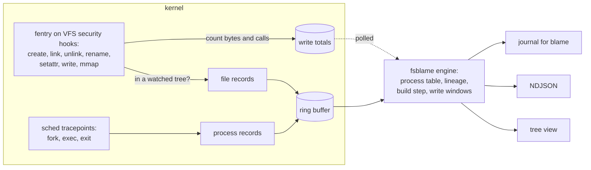

# fsblame

[](https://github.com/Arinerron/fsblame/actions/workflows/ci.yml)
[](LICENSE)

**Which command changed this file?** fsblame watches files and directory trees and prints
every change made to them (writes, creates, renames, links, deletes, chmod, chown, truncate)
together with the process that made it: its command line and working directory, every
ancestor up to init, its systemd unit or container, and the build step it ran under, such as
an npm `postinstall` script or a cargo build script. It uses eBPF and ships as one static
binary.

Here `npm run build` ran in another terminal while fsblame watched the project:

```console
$ sudo fsblame watch ~/webapp --depth 2
fsblame: watching /home/you/webapp for all ops; Ctrl-C to stop
~/webapp/dist  created dir  15:10:40  (0777)
  └─ mkdir -p dist                                        (pid 3243820, cwd ~/webapp)   [unit kitty-3186744-14.scope]   [npm lifecycle: build webapp@1.4.2 · high]
     └─ sh -c 'mkdir -p dist && cp src/index.js dist/bundle.tmp && …  (pid 3243819)
        └─ npm run build                                  (pid 3243806)
           └─ … 8 more ancestors
~/webapp/dist/bundle.tmp  created  15:10:40  (0644)
  └─ cp src/index.js dist/bundle.tmp                      (pid 3243821, cwd ~/webapp)   [unit kitty-3186744-14.scope]   [npm lifecycle: build webapp@1.4.2 · high]
     └─ sh -c 'mkdir -p dist && cp src/index.js dist/bundle.tmp && …  (pid 3243819)
        └─ npm run build                                  (pid 3243806)
           └─ … 8 more ancestors
~/webapp/dist/bundle.tmp  modified  15:10:40  (+21 B, 2 writes)
  └─ cp src/index.js dist/bundle.tmp                      (pid 3243821, cwd ~/webapp)   [unit kitty-3186744-14.scope]   [npm lifecycle: build webapp@1.4.2 · high]
     └─ sh -c 'mkdir -p dist && cp src/index.js dist/bundle.tmp && …  (pid 3243819)
        └─ npm run build                                  (pid 3243806)
           └─ … 8 more ancestors
~/webapp/dist/bundle.tmp → ~/webapp/dist/bundle.js  renamed  15:10:40
  └─ mv dist/bundle.tmp dist/bundle.js                    (pid 3243822, cwd ~/webapp)   [unit kitty-3186744-14.scope]   [npm lifecycle: build webapp@1.4.2 · high]
     └─ sh -c 'mkdir -p dist && cp src/index.js dist/bundle.tmp && …  (pid 3243819)
        └─ npm run build                                  (pid 3243806)
           └─ … 8 more ancestors
~/webapp/dist/bundle.js  chmod  15:10:40  (0644 → 0755)
  └─ chmod 755 dist/bundle.js     (pid 3243819, cwd ~/webapp)   [unit kitty-3186744-14.scope]   [npm lifecycle: build webapp@1.4.2 · high]
     └─ npm run build             (pid 3243806)
        └─ bash                   (pid 3243787)
           └─ … 7 more ancestors
fsblame: 5 changes reported
```

None of these processes outlived the build by more than a moment. fsblame saw each of them
start, so it still has their command lines, working directories and parents after they exit.
The `chmod` line carries the pid of the `sh`, which ran its last command with `exec`.

## Contents

- [Why](#why)
- [Install](#install)
- [Quick start](#quick-start)
- [Usage](#usage)
- [Output](#output)
- [Running as a service](#running-as-a-service)
- [Requirements and supported kernels](#requirements-and-supported-kernels)
- [Performance](#performance)
- [Limitations](#limitations)
- [How it works](#how-it-works)
- [Exit codes](#exit-codes)
- [Contributing, security and license](#contributing-security-and-license)

## Why

The usual tools tell you *that* a file changed, not *who* changed it in a way you can act on:

- **inotify** reports the change and nothing about the process.
- **fanotify** adds a pid. For the `cp`, `mv` or `sed -i` that a script or build step ran,
  that process has usually exited by the time you read the event, so its command line,
  working directory and parent are gone, and the pid may already belong to something else.
- **auditd** logs the pid, parent pid, executable and command line of each audited system
  call. Who started the parent, and which build step all of it belonged to, is left for you
  to piece together from other records.

fsblame follows every fork and exec on the system from the moment it starts, so it still
knows a process after it exits. Each change comes with the full chain of commands that led to
it, the systemd unit, container or tmux pane, and the build step it ran under, recognized from
the environment npm, pnpm, yarn, bun, cargo, pip and make give their child processes. Typical
questions it answers:

- Which dependency's install script rewrote my `~/.bashrc`, or a file in `/etc`?
- What in this build keeps touching `package-lock.json`?
- Which cron job or service rotates, truncates or chmods this file?
- What does `npm install` (or any command) change outside the project directory?

## Install

### From a release

Every release has static binaries for x86_64 and aarch64 Linux, with a SHA-256 checksum:

```sh
VERSION=v0.1.0
NAME=fsblame-$VERSION-$(uname -m)-linux-musl     # x86_64 or aarch64
curl -fLO https://github.com/Arinerron/fsblame/releases/download/$VERSION/$NAME.tar.gz
curl -fLO https://github.com/Arinerron/fsblame/releases/download/$VERSION/$NAME.tar.gz.sha256
sha256sum -c $NAME.tar.gz.sha256
tar -xzf $NAME.tar.gz
sudo install -m 0755 $NAME/fsblame /usr/local/bin/fsblame
```

The archive also holds shell completions (bash, zsh, fish, elvish, PowerShell), man pages and
a [systemd unit](#running-as-a-service):

```sh
sudo install -Dm 0644 $NAME/completions/fsblame.bash /usr/local/share/bash-completion/completions/fsblame
sudo install -Dm 0644 $NAME/completions/_fsblame /usr/local/share/zsh/site-functions/_fsblame
sudo install -Dm 0644 $NAME/completions/fsblame.fish /usr/local/share/fish/vendor_completions.d/fsblame.fish
sudo install -Dm 0644 -t /usr/local/share/man/man1 $NAME/man/*.1
```

`fsblame completions <SHELL>` prints the same scripts.

### Privileges: sudo or setcap

fsblame loads BPF programs, which needs `CAP_BPF` and `CAP_PERFMON`. Either run it with
`sudo`, as the examples here do, or give the binary those capabilities once:

```sh
sudo setcap cap_bpf,cap_perfmon+ep /usr/local/bin/fsblame
fsblame watch ~/webapp
```

Things to know about `setcap`:

- Every user who can execute the binary can then watch any path and read every user's command
  lines. On a shared machine, restrict who may run it (for example `chmod 0750` and a group).
- File capabilities are ignored on `nosuid` mounts (often `/tmp` and some home directories),
  and are removed when the file is replaced: run `setcap` again after every upgrade.
- Without `CAP_SYS_PTRACE` (root has it), the command lines and working directories of other
  users' processes that started before fsblame are not readable; `fsblame doctor` says so.

Without either, fsblame prints what is missing, including the `setcap` line for its own path,
and exits with status 4.

### From source

You need a Rust toolchain ([rustup](https://rustup.rs) installs the version pinned in
`rust-toolchain.toml`) and clang, which compiles the BPF programs. The shared crates live in
the [tracekit](https://github.com/Arinerron/tracekit) submodule:

```sh
git clone --recurse-submodules https://github.com/Arinerron/fsblame.git
cd fsblame
cargo build --release --target x86_64-unknown-linux-musl
sudo install -m 0755 target/x86_64-unknown-linux-musl/release/fsblame /usr/local/bin/fsblame
```

For aarch64, add the target with `rustup target add aarch64-unknown-linux-musl` and build with
`--target aarch64-unknown-linux-musl`; the bundled `rust-lld` links it, no cross compiler
needed. [CONTRIBUTING.md](CONTRIBUTING.md) covers tests, benchmarks and fuzzing.

## Quick start

```sh
sudo fsblame doctor ~/proj                   # can fsblame run here, and what would it miss?
sudo fsblame watch ~/proj                    # print each change as it happens; Ctrl-C stops
sudo fsblame ~/proj                          # the same: watch is the default command
sudo fsblame run -- npm install              # everything npm and its children change, anywhere
sudo fsblame record /etc                     # keep a journal (better: the systemd unit below)
sudo fsblame blame /etc/hosts                # ...and ask it later who changed a file
```

## Usage

`fsblame <COMMAND> --help` and `man fsblame-<command>` list every option. Paths may be files
or directories; a directory includes its whole subtree, including the filesystems mounted
below it when fsblame starts.

### `watch`: changes as they happen

```sh
sudo fsblame watch ~/proj ~/.config                       # several paths at once
sudo fsblame watch ~/proj --exclude ~/proj/target         # ignore a subtree (repeatable)
sudo fsblame watch ~/proj --op write,rename,unlink        # only these operations
sudo fsblame watch ~/proj --duration 10m --summary        # stop after 10 minutes, then summarize
sudo fsblame watch ~/proj --json > changes.ndjson         # one JSON object per change
sudo fsblame watch ~/proj --tree 4242                     # only process 4242 and its descendants
```

| Option | Meaning |
|--------|---------|
| `--json` | Print [NDJSON](docs/json.md) instead of the tree view. |
| `--depth N` | Ancestors shown per change in the tree view (default 4); JSON always has all of them. |
| `--color auto\|always\|never` | Color the tree view; `auto` colors a terminal unless `NO_COLOR` is set. |
| `--summary` | When stopping, print the changes grouped by build step or command. |
| `-q`, `--quiet` | Only warnings and errors on stderr: no start banner, no final count. |
| `--duration D` | Stop after `250ms`, `30s`, `5m`, `1h`, `7d`; otherwise Ctrl-C, SIGTERM or SIGHUP stop it. |
| `--tree PID` | Only changes by this process and its descendants, those running now and those it starts later (repeatable). |
| `--exclude PATH` | Ignore changes below this path (repeatable). |
| `--ring-size SIZE` | Kernel ring buffer, a power of two from `256K` to `1G` (default `16M`). Raise it if fsblame warns that records were lost. |
| `--ready-fd N` | Write `ready` to file descriptor N once watching, for scripts. |

With `--summary`, the tree view ends like this (same build as above):

```text
summary: 5 changes
  GROUP                              CHANGES  PATHS  OPS                                            FIRST PATHS
  npm lifecycle: build webapp@1.4.2        5      3  write 1, create 1, mkdir 1, rename 1, chmod 1  ~/webapp/dist, ~/webapp/dist/bundle.tmp, ~/webapp/dist/bundle.js
```

### Filters

`watch`, `run`, `record` and `blame` share these. Different kinds must all match; values of
one kind are alternatives; `--ignore-comm` wins over everything else.

| Filter | Reports only changes |
|--------|----------------------|
| `--op LIST` | of these operations: `write`, `create`, `mkdir`, `mknod`, `symlink`, `link`, `unlink`, `rmdir`, `rename`, `chmod`, `chown`, `truncate`, `utimes`, `setattr` |
| `--include GLOB` | to paths matching the glob (repeatable): `*.lock` matches the name anywhere, `/etc/**` an absolute subtree, `node_modules/` any directory of that name; a rename or link matches by either path |
| `--comm LIST` | by threads with these names (the first 15 bytes, as in `ps -o comm`) |
| `--ignore-comm LIST` | except those by threads with these names |
| `--uid LIST` | by processes with these real uids |
| `--unit LIST` | made in these systemd units (`.service` or `.scope` may be left out) |
| `--pid LIST` | by these process ids |

```sh
sudo fsblame watch ~ --include '.bashrc' --include '.profile' --include '.ssh/**'
sudo fsblame watch /etc --ignore-comm dpkg,apt --summary
```

`--op` applies in the kernel: operations you did not ask for are never recorded, and most of
their programs are not even loaded. The other filters apply in fsblame's userspace.

### `run`: everything one command changes

```sh
sudo fsblame run -- npm install                   # every filesystem
sudo fsblame run ~/proj -- make                   # only below ~/proj
sudo fsblame run --json -o changes.ndjson -- ./install.sh
```

`run` starts the command and reports every change made by it and by every process it starts.
Without paths it watches every filesystem except the pseudo ones (proc, sysfs, cgroup,
debugfs and the like). Under `sudo`, the command runs as you, with your `HOME`, `USER`,
`LOGNAME` and `SHELL`. The report goes to stderr, or to the file given with `-o` (owned by
you, not root), because the command owns stdout; Ctrl-C goes to the command, and fsblame
stops when the command exits.
`run` takes the filters and output options of `watch`, but not `--duration`, `--tree` or
`--ready-fd`.

Here it shows that `npm run build` also writes and prunes npm's log files in your home
directory (an excerpt; npm's own messages are interleaved on the same terminal):

```console
$ sudo fsblame run --depth 1 -- npm run build
fsblame: watching every filesystem for all ops by `npm run build` and the processes it starts, until it exits
~/.npm/_logs/2026-10-16T22_11_57_919Z-debug-0.log  created  15:11:57  (0644)
  └─ npm run build                              (pid 3252998, cwd ~/webapp)   [unit kitty-3186744-14.scope]
     └─ fsblame run --depth 1 -- npm run build  (pid 3252997)
        └─ … 8 more ancestors
npm notice run webapp@1.4.2 build
npm notice run mkdir -p dist && cp src/index.js dist/bundle.tmp && mv dist/bundle.tmp dist/bundle.js && chmod 755 dist/bundle.js
~/.npm/_logs/2026-10-16T19_30_36_235Z-debug-0.log  deleted  15:11:57
  └─ npm run build                              (pid 3252998, cwd ~/webapp)   [unit kitty-3186744-14.scope]
     └─ fsblame run --depth 1 -- npm run build  (pid 3252997)
        └─ … 8 more ancestors
[... the five changes in ~/webapp/dist shown at the top ...]
~/.npm/_logs/2026-10-16T22_11_57_919Z-debug-0.log  modified  15:11:58  (+902 B, 21 writes)
  └─ npm run build                              (pid 3252998, cwd ~/webapp)   [unit kitty-3186744-14.scope]
     └─ fsblame run --depth 1 -- npm run build  (pid 3252997)
        └─ … 8 more ancestors
fsblame: 8 changes reported
```

`run` exits with the command's status (128 + N if signal N killed it, 127 if it was not found,
126 if it could not be executed), unless fsblame itself fails; see [Exit codes](#exit-codes).

### `record` and `blame`: who changed it while nobody was watching

`record` watches like `watch` and appends each change to a journal of NDJSON files.
`blame` answers from that journal, in the same tree view `watch` prints:

```sh
sudo fsblame record /etc /usr/local --exclude /usr/local/share   # runs until stopped
sudo fsblame blame /etc/hosts                              # every recorded change to it
sudo fsblame blame /etc --since 2h --op chmod,chown        # what changed permissions lately
sudo fsblame blame /etc/nginx --since 2026-10-16T14:00:00Z --until 2026-10-16T15:00:00Z
sudo fsblame blame /etc/hosts --limit 1 --json             # the latest change, as NDJSON
```

| Option | Meaning |
|--------|---------|
| `--journal DIR` | The journal directory, for both commands (default `/var/lib/fsblame`). `record` creates it with mode 0700 and its files with mode 0600: they hold every user's command lines. |
| `--max-size SIZE` | `record`: start a new file before one would grow beyond this (default `64M`, at least `64K`). |
| `--keep N` | `record`: keep this many files and delete older ones (default 8). |
| `--since TIME`, `--until TIME` | `blame`: an RFC 3339 time such as `2026-10-16T16:00:00+02:00`, or how long ago, such as `30m`, `2h`, `7d`. |
| `--limit N` | `blame`: only the N most recent matching changes. |

`blame PATH` matches a change by any of its paths (a rename's old name, a link's target), and
a directory matches everything below it; the file need not exist any more. Without paths it
shows every recorded change. The [systemd unit](#running-as-a-service) runs `record` from
boot.

### `doctor`: can it run here?

```sh
sudo fsblame doctor ~/proj
sudo fsblame doctor --json ~/proj | jq .ops
```

`doctor` checks the kernel version and BTF, privileges, lockdown and security modules, then
loads every program of the real tracer and reports, for each of the 14 operations, whether
this kernel can report it and why not if it cannot. It also checks the filesystems of the
paths you give (overlays, network and FUSE mounts). On a machine where everything works:

```text
fsblame doctor · kernel 7.2.6-arch2-1 x86_64
 PASS platform.os_arch       Linux x86_64
 PASS kernel.version         7.2.6 ≥ 5.17
 PASS kernel.btf             /sys/kernel/btf/vmlinux present
 PASS priv.capabilities      CAP_BPF, CAP_PERFMON effective
 ...
 PASS probe.fentry_security  fentry attached to security_inode_unlink and all 16 tracer hooks
 PASS probe.sched_tp         tp_btf attached to sched_process_fork, sched_process_exec and sched_process_exit
 PASS probe.ops              all 14 operations available; largest program on_rename verified in 3,208 of 1,000,000 instructions
 PASS fsblame.watchfs        /home/you/webapp on ext4
summary: 0 fail · 0 warn · 23 pass · 3 info · 1 skip → fsblame is ready
```

Each failing or warning check names what it breaks and how to fix it. Please include
`sudo fsblame doctor --json` in bug reports.

## Output

### The tree view

Each change is one header line and a tree of the processes behind it:

```text
PATH  VERB  TIME  (DETAIL)
  └─ ACTOR'S COMMAND LINE  (pid, cwd)   [unit · container · tmux pane]   [build step · confidence]
     └─ PARENT'S COMMAND LINE  (pid)
        └─ … N more ancestors
```

- The verb is one of `modified`, `created`, `created dir`, `created node`, `symlinked`,
  `hard-linked`, `deleted`, `removed dir`, `renamed`, `chmod`, `chown`, `truncated`,
  `touched` (timestamps) and `attrs changed`. A rename shows `OLD → NEW` as its path.
- The detail says what changed: `(+21 B, 2 writes)`, `(shared writable mapping, mmap)`,
  `(0644 → 0755)`, `(→ uid 1000, gid 1000)`, `(→ 0 B)`, `(→ target)` for a symlink,
  `(= existing path)` for a hard link, `(fifo 0:0)`, or the mode of a new file.
- Writes are coalesced per process and file. The line appears once the file has been quiet for
  200 ms or after 1 s of continuous writing, when the process execs or exits, before another
  change to the same file, or when fsblame stops.
- Process facts: `pid`, `ns pid` for a process in a container's pid namespace, `exited HH:MM:SS`
  when it had exited, and `cwd` where it differs from the line above. A process fsblame has no
  record of shows as `comm (pid N, not tracked)`.
- The build step tag sits on the process whose environment identified it.
- Paths below your home directory are shown with `~`, also under `sudo`.

`--depth` sets how many ancestors are shown. `--color` makes the path bold, colors the verb by
kind of change and dims the ancestors.

### NDJSON

`--json` prints one object per line: a `touch` per change, `lost` when the kernel side lost
data, and a `summary` with `--summary`. Every line carries the schema version `v` (currently
1); fields are only added within a version. The schema, every field, and jq recipes are in
[docs/json.md](docs/json.md).

```sh
sudo fsblame watch ~/proj --json | jq --unbuffered -r 'select(.type == "touch") | "\(.op) \(.path) by \(.proc.comm)"'
```

### Losses

If changes arrive faster than fsblame can read them, the kernel drops records rather than
slowing the system down. fsblame never hides this: it prints a warning on stderr (or a
`lost` line in JSON) at most once per second while it happens, and a total when it stops. A
larger `--ring-size` helps.

## Running as a service

[`contrib/systemd/fsblame-record.service`](contrib/systemd/fsblame-record.service) runs
`fsblame record` from boot, so `fsblame blame` can answer for changes made while nobody was
watching. It runs with only the capabilities fsblame needs and a hardened sandbox; the
comments in the unit explain each setting. It expects the binary at `/usr/local/bin/fsblame`,
where the [install steps](#install) put it. The release archive carries the unit and its
settings file in `systemd/`; from the directory you extracted it in:

```sh
sudo install -m 0644 $NAME/systemd/fsblame-record.service /etc/systemd/system/
sudo install -m 0644 $NAME/systemd/fsblame.default /etc/default/fsblame
sudoedit /etc/default/fsblame               # set FSBLAME_PATHS, optionally FSBLAME_ARGS
sudo systemctl daemon-reload
sudo systemctl enable --now fsblame-record.service
```

From a source checkout, install `contrib/systemd/fsblame-record.service` and
`contrib/systemd/fsblame.default` the same way.

[`/etc/default/fsblame`](contrib/systemd/fsblame.default) holds two settings:

| Variable | Meaning |
|----------|---------|
| `FSBLAME_PATHS` | The files and directories to record, separated by spaces (default `/etc /usr/local`). |
| `FSBLAME_ARGS` | Further `record` options, such as `--exclude /usr/local/share --ignore-comm unattended-upgr --keep 16`. |

The journal is `/var/lib/fsblame`, readable only by root. Then:

```sh
sudo fsblame blame /etc/hosts
sudo fsblame blame --since 2h /etc
journalctl -u fsblame-record                # why it failed to start, if it did
```

The service is not restarted after a usage error, missing privileges or an unsupported kernel
(exit status 2, 4 or 5); `fsblame doctor` explains those.

## Requirements and supported kernels

- Linux 5.17 or newer (fsblame needs `bpf_loop`), with BTF at `/sys/kernel/btf/vmlinux`
  (`CONFIG_DEBUG_INFO_BTF`) and fentry support. The kernels of the major distributions enable
  both.
- x86_64 or aarch64.
- Root, or `CAP_BPF` and `CAP_PERFMON` (see [Privileges](#privileges-sudo-or-setcap)).
- fsblame runs on the host, in the initial pid namespace; it sees containers' processes from
  there.

`fsblame doctor` checks all of this.

CI runs the full end-to-end suite on x86_64 virtual machines booting Linux 5.17, 6.1, 6.6,
6.12 and 7.2 (Ubuntu mainline builds). The aarch64 binary is built and smoke-tested under
qemu-user, but the suite does not run on aarch64 kernels yet.

Beyond the 5.17 floor, two things depend on the kernel:

| Feature | Needs | Without it |
|---------|-------|------------|
| Confirmed creates | `security_file_post_open`, Linux 6.9 | Opening an existing file with `O_CREAT` (as `>>` in a shell does) can be reported as a `create` when its name was not in the kernel's dentry cache. The write itself is reported correctly. |
| `watch --tree` | `CONFIG_PROC_CHILDREN` | `--tree` exits with status 5. |

When a program cannot be attached, fsblame names it at start and says what is missing
without it, for example `security_file_post_open` before 6.9; `doctor` shows the same as a
warning under `probe.ops`. Differences in kernel internals, such as the arguments of
`security_inode_setattr` (changed in 6.0, and backported by some distributions), are read from
the running kernel's BTF.

Stock kernels of common distributions:

| Distribution | Kernel | Runs fsblame |
|--------------|--------|--------------|
| Ubuntu 22.04 LTS | 5.15 (GA) | No. The HWE kernel (6.8) does. |
| Ubuntu 24.04 LTS | 6.8 | Yes; creates are not confirmed (6.8 < 6.9). |
| Debian 11 | 5.10 | No. |
| Debian 12 | 6.1 | Yes; creates are not confirmed. |
| Debian 13 | 6.12 | Yes. |
| Fedora (current releases) | 6.x, recent | Yes. |
| Arch Linux | latest stable | Yes. |
| RHEL, Rocky Linux, AlmaLinux 9 | 5.14 with backports | No. fsblame refuses kernels older than 5.17 by version (exit status 5), although Red Hat has backported `bpf_loop` (listed as available from [RHEL 9.2](https://docs.redhat.com/en/documentation/red_hat_enterprise_linux/9/html/9.2_release_notes/available_bpf_features)). Not tested. |

"Yes" means the kernel meets the requirements; only the mainline versions listed above run in
CI. Run `sudo fsblame doctor` to be sure.

## Performance

fsblame's programs run inside the kernel functions every file operation passes through, so
watching has a cost even for files you do not watch. Most of it is paid by writes. Measured
with `cargo xtask bench` on an Intel Core Ultra 7 155H (22 CPUs) running Linux 7.2.6, median
of three runs, workloads pinned to one CPU, on a busy machine (load average about 5):

```text
workload           ops   without/s      with/s  overhead     cpu   cpu/op touches ring lost evicted  peak rss
exec storm        2000        2141        2068     +3.5%   0.07s   35.0us       0         0       0  23.5 MiB
file churn       20000       43814       35696    +22.7%   0.82s   41.0us   80000         0       0  23.5 MiB
writes inside  2000000     2186956     1649419    +32.6%   0.00s    0.0us       2         0       0  23.6 MiB
writes outside 2000000     2222403     1863132    +19.3%   0.01s    0.0us       0         0       0  23.7 MiB
mmap churn      500000      476513      455712     +4.6%   0.01s    0.0us       1         0       0  23.5 MiB
```

| Workload | What it does |
|----------|--------------|
| exec storm | Spawns `/bin/true` and waits for it, 2,000 times: fork, exec and exit, nothing changed in the watched tree. |
| file churn | Creates a file in the watched tree, writes 4 KiB, renames and deletes it: four reported changes per file. |
| writes inside | 64-byte `pwrite` calls to one file in the watched tree. |
| writes outside | The same, to a file next to the watched tree on the same filesystem. |
| mmap churn | Maps a watched file shared and writable and unmaps it, through one open file. |

| Column | Meaning |
|--------|---------|
| without/s, with/s | Operations per second without fsblame and with `fsblame watch --json` attached. |
| overhead | The extra time per operation with fsblame attached. |
| cpu, cpu/op | fsblame's own CPU time from attaching until it had reported the workload, in total and per operation. |
| touches | Changes reported. |
| ring lost, evicted | Records dropped with the ring buffer full; write totals evicted before they were read. |
| peak rss | fsblame's peak resident memory. |

What that means in absolute terms:

- A write call to a watched file costs about 0.15 µs more (0.46 to 0.61 µs here); one to an
  unwatched file on a watched filesystem about 0.09 µs more. Writes on filesystems that hold
  no watched path stop at a device-number compare. A 64-byte `pwrite` is about the cheapest
  write there is: the relative overhead shrinks as the work per call grows.
- Coalescing keeps fsblame's own work independent of the number of writes: two million writes
  became two reported changes.
- fsblame's own CPU time is about 10 µs per reported change (41 µs per churned file, which
  makes four changes) and about 35 µs per process started anywhere on the system.
- Memory: an idle `watch` holds about 19 MiB, most of it the kernel ring buffer it reads
  (roughly 2.5 MiB plus `--ring-size`), and peaks at about 24 MiB while loading its programs.

Numbers vary by about plus or minus four points between runs on a busy machine.
`cargo xtask bench` measures your own machine; see [CONTRIBUTING.md](CONTRIBUTING.md#benchmarks).

## Limitations

- **Only what happens while fsblame runs.** Changes before the `fsblame: watching` line are
  not reported. For history, keep [`record`](#running-as-a-service) running.
- **Local filesystems.** On NFS, SMB and other network filesystems, changes made by other
  machines are never seen. On FUSE filesystems, the daemon's writes to its backing store are
  attributed to the daemon. `doctor` warns about both.
- **Overlays** (container root filesystems) are reported once, at the path in the merged view.
  An overlay mounted in another mount namespace, such as rootless Podman's, is not visible:
  its upper layer is reported as a plain directory. Writes through a shared mapping of an
  overlay file made writable with `mprotect(2)` are not seen.
- **Mounts made later.** A filesystem mounted below a watch root after fsblame started is not
  watched. Paths on a filesystem mounted after the start (seen by `run` without paths) are
  shown as `<dev MAJOR:MINOR>/path`.
- **Long paths** are cut at 1024 bytes or 64 directory levels below their root, keeping the
  lowest part, and are marked truncated.
- **Working directory** is the one at exec (or inherited at fork). A process that changes
  directory later, such as a shell running `cd`, still shows the old one.
- **Command lines** longer than 4 KiB are cut, and environments longer than 8 KiB lose their
  middle part, where build-step variables are rarely set.
- **Byte counts** are what each write call asked for, not what it wrote. Stores through a
  shared writable mapping are reported once, when the mapping becomes writable.
- **`run` and `watch --tree`** follow the process tree. Work a command causes outside it (a
  systemd unit it starts, D-Bus activation, a Docker daemon) is not included, and `run` stops
  when the command exits, so descendants still running after that are not reported further.

## How it works

fsblame attaches BPF programs (fentry) to the kernel's VFS security hooks, which every create,
link, unlink, rename, attribute change and write passes through, and to the scheduler's
fork, exec and exit tracepoints. In the kernel, each hook decides whether the file is in a
watched tree, with a per-dentry cache so unwatched files cost almost nothing, rebuilds its
path, and sends a record through a ring buffer; write calls are only counted there, per
process and open file. Exec records carry the command line, working directory and
environment. In userspace, fsblame rebuilds the process tree from those records (and from
`/proc` for processes that predate it), coalesces the write counts into one change per
process and file, recognizes the build step from the environment of the process chain, and
prints each change with its lineage.



[AGENTS.md](AGENTS.md) describes the design in detail: every program and map, the verifier
budget, the overlay model and the tests.

## Exit codes

| Status | Meaning |
|--------|---------|
| 0 | Stopped cleanly (Ctrl-C, SIGTERM, SIGHUP, `--duration`, or a closed output pipe). |
| 2 | Usage error, such as an unknown option or a path that does not exist. |
| 4 | Missing privileges; fsblame prints what is missing and how to grant it. |
| 5 | The kernel lacks something fsblame needs. |
| 6 | Runtime error after start-up, such as a full disk under `record`. |

`fsblame run` exits with the command's status, 128 + N if signal N killed it, 127 if it was
not found and 126 if it could not be executed. Its own failures end with an `fsblame:` line on
stderr and status 2, 4 or 5 before the command starts, or 6 after waiting for it.

## Contributing, security and license

- [CONTRIBUTING.md](CONTRIBUTING.md): building, tests, the end-to-end suite and pull requests.
- [SECURITY.md](SECURITY.md): please report vulnerabilities privately.
- [CODE_OF_CONDUCT.md](CODE_OF_CONDUCT.md).
- [CHANGELOG.md](CHANGELOG.md).

fsblame is released under the [MIT License](LICENSE). Copyright Aaron Esau.
